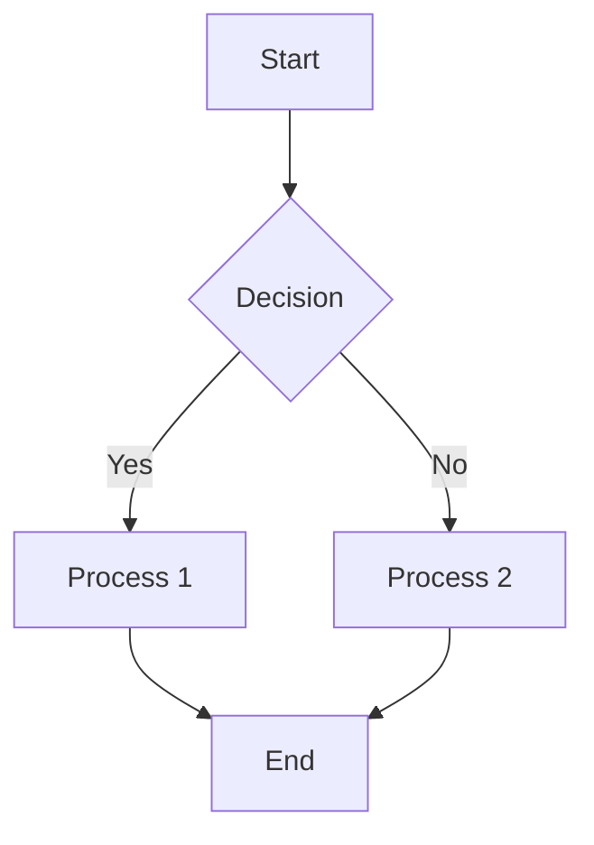
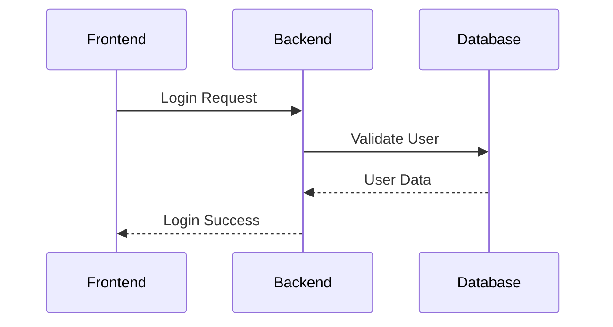
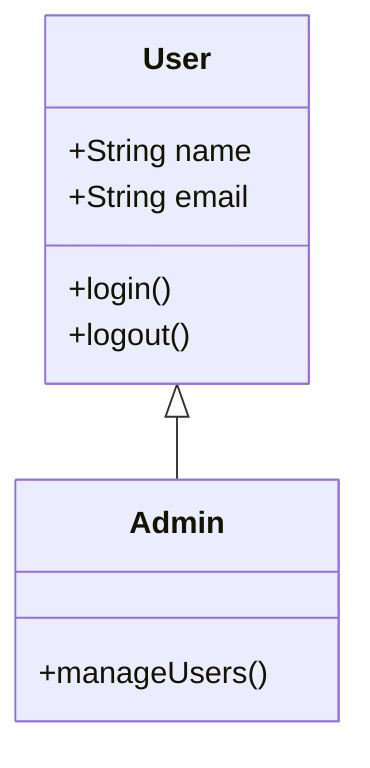
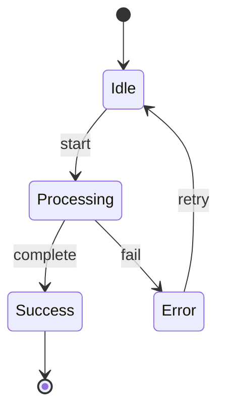
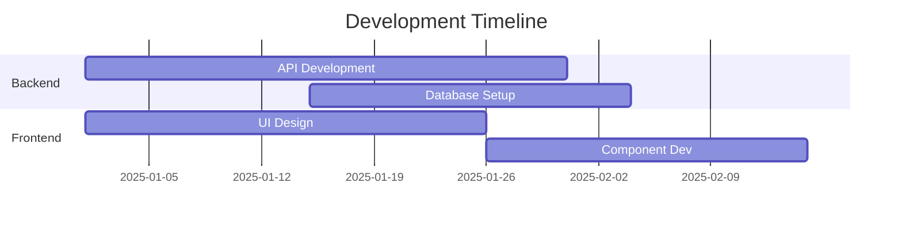
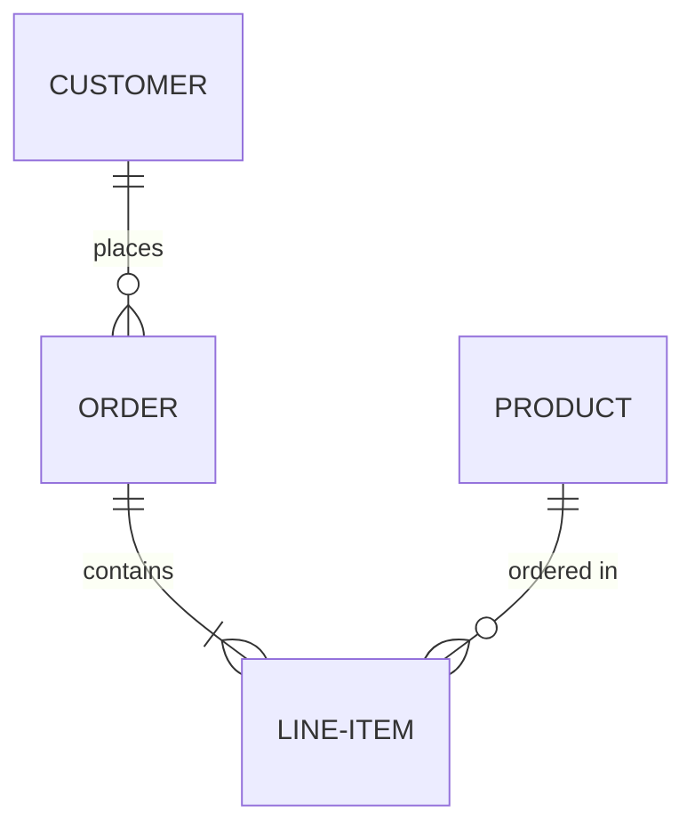
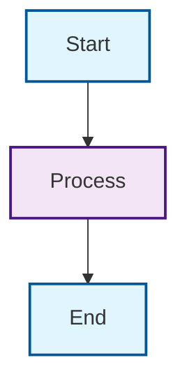
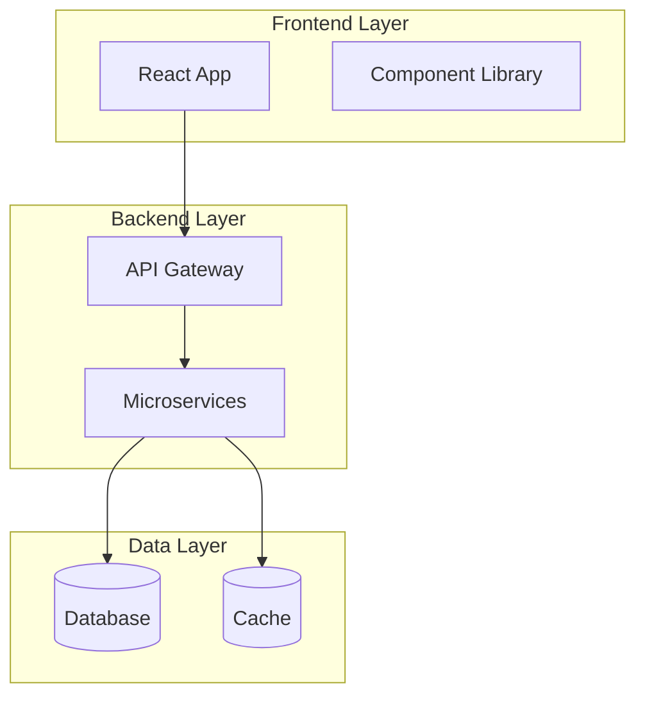
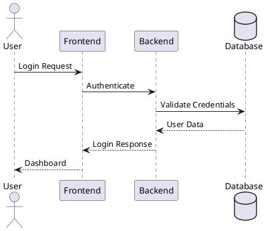
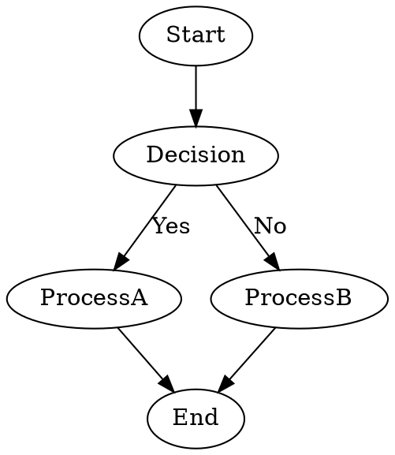

# Mermaid Diagramming Guide

## Overview

Mermaid is a JavaScript-based diagramming and charting tool that uses Markdown-inspired text definitions to create dynamic diagrams. It's particularly valuable for technical documentation because diagrams are defined as code, making them version-controllable, easily maintainable, and perfect for collaborative development.

## What is Mermaid?

Mermaid transforms textual descriptions into visual diagrams, supporting various diagram types including flowcharts, sequence diagrams, Gantt charts, class diagrams, and more. The key advantage is that diagrams are defined in plain text, making them:

- **Version Controllable**: Store diagram definitions alongside code in Git
- **Maintainable**: Easy to update and modify without specialized tools
- **Collaborative**: Multiple developers can edit diagrams using standard text editors
- **Platform Independent**: Renders consistently across different systems and tools

## Mermaid Syntax & Capabilities

### 1. Flowcharts (Most Common)



**Syntax Elements:**
- `graph TD` = Top-Down flowchart
- `graph LR` = Left-Right flowchart  
- `[]` = Rectangle nodes
- `{}` = Diamond (decision) nodes
- `()` = Rounded rectangle nodes
- `-->` = Arrows
- `-->|text|` = Labeled arrows

### 2. Sequence Diagrams



**Key Features:**
- Perfect for API interactions
- Shows time-based message flow
- Supports synchronous/asynchronous calls

### 3. Class Diagrams



### 4. State Diagrams



### 5. Gantt Charts



### 6. ER Diagrams



## Advanced Mermaid Features

### Styling & Theming

**Custom Colors:**


**Themes:**
- `default` - Standard blue theme
- `dark` - Dark background theme
- `neutral` - Minimal gray theme
- `forest` - Green theme
- `base` - Customizable base theme

### Subgraphs & Complex Layouts



## Mermaid Integration & Tools

### Supported Platforms

**Documentation Platforms:**
- **GitLab**: Native Mermaid support in markdown files
- **GitHub**: Renders Mermaid in README files and issues
- **Notion**: Supports Mermaid code blocks
- **Obsidian**: Excellent Mermaid plugin support
- **Docsify**: Built-in Mermaid plugin
- **GitBook**: Native rendering support

**Development Tools:**
- **VS Code**: Mermaid Preview extension
- **JetBrains IDEs**: Mermaid plugin available
- **Cursor IDE**: Built-in Mermaid rendering (as we've seen!)
- **Online Editor**: https://mermaid.live for testing

### Embedding in Web Applications

**JavaScript Integration:**
```javascript
import mermaid from 'mermaid';

mermaid.initialize({
    startOnLoad: true,
    theme: 'default',
    securityLevel: 'loose'
});
```

**HTML Usage:**
```html
<div class="mermaid">
graph TD
    A[Start] --> B[End]
</div>
```

## Limitations of Mermaid

### 1. **Complexity Limitations**

**Diagram Size Constraints:**
- Large diagrams (100+ nodes) become difficult to read
- Performance issues with very complex flowcharts
- Automatic layout can produce suboptimal positioning

**Layout Control:**
- Limited control over exact node positioning
- Automatic layout algorithms sometimes produce odd arrangements
- Difficult to create pixel-perfect designs

### 2. **Visual Styling Limitations**

**Limited Customization:**
- Basic shape options compared to dedicated diagramming tools
- Limited font and typography controls
- No support for images or complex graphics
- Constrained color palette and styling options

**Professional Presentation:**
- Not suitable for client-facing presentations requiring polished graphics
- Limited export formats (mainly SVG/PNG)
- No animation or interactive features

### 3. **Learning Curve & Syntax**

**Syntax Complexity:**
- Each diagram type has different syntax rules
- Error messages can be cryptic
- Debugging layout issues requires trial and error
- Syntax varies between Mermaid versions

### 4. **Tool Support Inconsistencies**

**Rendering Differences:**
- Different platforms may render diagrams slightly differently
- Version compatibility issues between tools
- Some advanced features not supported in all environments

## Alternative Diagramming Approaches

### 1. ASCII Art (The Classic Alternative! 📜)

**Simple Flowcharts:**
```
    ┌─────────┐
    │  Start  │
    └────┬────┘
         │
         ▼
    ┌─────────┐      Yes   ┌─────────┐
    │Decision?├──────────►│Process A│
    └────┬────┘           └─────────┘
         │
         │ No
         ▼
    ┌─────────┐
    │Process B│
    └─────────┘
```

**Network Diagrams:**
```
Internet ── Router ── Switch ── Server Farm
    │          │         │         │
    │          │         ├─── Web Server 1
    │          │         ├─── Web Server 2
    │          │         └─── Database
    │          │
    │          └─── WiFi Access Point
    │                      │
    │                      ├─── Laptop 1
    │                      └─── Mobile Device
    │
    └─── Firewall ── DMZ ── Public Services
```

**ASCII Art Advantages:**
- **Universal Compatibility**: Works in any text editor or terminal
- **Version Control Friendly**: Pure text, perfect for Git diffs
- **No Dependencies**: No special tools or rendering engines required
- **Retro Cool Factor**: Nostalgic appeal for veteran developers
- **Terminal Native**: Perfect for CLI tools and documentation

**ASCII Art Tools:**
- **asciiflow.com**: Browser-based ASCII diagram editor
- **ditaa**: Converts ASCII art to proper diagrams
- **boxes**: Command-line tool for drawing ASCII boxes
- **figlet**: For ASCII text art headers

### 2. PlantUML

**More Powerful Text-Based Diagramming:**


**PlantUML Advantages:**
- More comprehensive than Mermaid
- Better layout algorithms
- Extensive customization options
- Strong enterprise adoption

### 3. Graphviz/DOT

**Graph Description Language:**


### 4. Modern Visual Tools

**When to Use Professional Tools:**

**Lucidchart/Draw.io:**
- Client presentations requiring polished visuals
- Complex diagrams needing precise positioning
- Collaborative editing with non-technical stakeholders

**Figma/Sketch:**
- UI/UX design workflows
- High-fidelity mockups and prototypes
- Design system documentation

**Enterprise Tools (Visio, OmniGraffle):**
- Large-scale enterprise architecture diagrams
- Compliance documentation requiring specific formats
- Integration with Microsoft Office workflows

### 5. Code-Generated Diagrams

**Architecture as Code:**
```python
# Using Python libraries like diagrams
from diagrams import Diagram
from diagrams.aws.compute import EC2
from diagrams.aws.database import RDS

with Diagram("Web Service", show=False):
    web = EC2("Web Server")
    db = RDS("Database")
    web >> db
```

## Best Practices for Choosing Diagramming Tools

### Use Mermaid When:
- ✅ Creating technical documentation for developers
- ✅ Diagrams need to be version controlled with code
- ✅ Simple to moderate complexity diagrams
- ✅ Team collaboration on diagram content
- ✅ Rapid prototyping and iteration
- ✅ Embedding in GitHub/GitLab documentation

### Use ASCII Art When:
- ✅ Terminal-based documentation
- ✅ Maximum compatibility requirements
- ✅ Simple network diagrams
- ✅ Retro aesthetic desired
- ✅ Command-line tool documentation
- ✅ Emergency documentation (no tools available)

### Use Professional Tools When:
- ✅ Client-facing presentations
- ✅ Complex enterprise architecture
- ✅ Pixel-perfect design requirements
- ✅ Non-technical stakeholder collaboration
- ✅ Marketing or sales materials
- ✅ Compliance documentation

## Mermaid in VeoGen Documentation

### Our Usage Patterns

**Architecture Documentation:**
- System flow diagrams (like our VeoGen video generation flow)
- Component interaction diagrams
- Database relationship diagrams

**Process Documentation:**
- User journey flows
- Development workflows
- Deployment pipelines

**API Documentation:**
- Sequence diagrams for API interactions
- State transition diagrams for API workflows
- Error handling flows

### Integration with Docsify

Our documentation system uses Docsify with Mermaid plugin:

```javascript
// docsify configuration
window.$docsify = {
    mermaid: {
        theme: 'default',
        themeVariables: {
            primaryColor: '#ff0000'
        }
    }
};
```

### Best Practices for VeoGen Docs

1. **Keep Diagrams Focused**: One concept per diagram
2. **Use Consistent Styling**: Apply uniform color schemes and node shapes
3. **Add Descriptive Text**: Always accompany diagrams with detailed explanations
4. **Version Control**: Track diagram changes alongside code changes
5. **Regular Updates**: Keep diagrams current with system changes

## Future of Diagramming

### Emerging Trends

**AI-Generated Diagrams:**
- Tools like Whimsical and Creately now offer AI diagram generation
- Natural language to diagram conversion becoming mainstream
- AI-powered layout optimization and suggestions

**Interactive Diagrams:**
- Real-time collaborative editing
- Clickable diagrams with drill-down capabilities
- Integration with live system data

**Code Integration:**
- Automatic diagram generation from code analysis
- Live updating diagrams based on system state
- Integration with CI/CD pipelines for documentation automation

### Recommendations for Teams

1. **Start Simple**: Begin with Mermaid for most technical documentation
2. **Have Alternatives Ready**: Keep ASCII art skills for emergency situations
3. **Tool Diversity**: Use the right tool for the right audience
4. **Documentation Culture**: Make diagrams a standard part of development process
5. **Accessibility**: Ensure diagrams are accessible to all team members

Mermaid strikes an excellent balance between simplicity and functionality, making it perfect for technical teams who need to create and maintain diagrams efficiently. While it has limitations, its integration into development workflows and version control makes it invaluable for modern software documentation.

## Fun Fact: ASCII Art History

ASCII art has been around since the 1960s and was essential in early computing when graphical displays were rare or non-existent. The practice continues today not just for nostalgia, but because text-based diagrams have genuine technical advantages in many scenarios. Plus, there's something deeply satisfying about creating a beautiful diagram using nothing but keyboard characters! 🎨

```
     ╭─────────────────────────╮
     │  "Happy Diagramming!"  │
     ╰─────────────────────────╯
                 │
                 ▼
        ┌─────────────────┐
        │    Keep it     │
        │    simple!     │
        └─────────────────┘
``` 