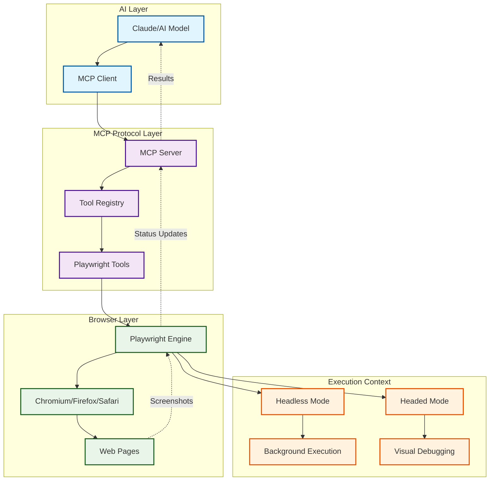

# Playwright MCP: The Complete Guide to Invisible Browser Automation

## Overview

Playwright MCP (Model Context Protocol) represents a revolutionary advancement in AI-powered browser automation. It enables Large Language Models (LLMs) like Claude to directly control web browsers through a standardized protocol, making web testing, scraping, and automation "invisible" and seamlessly integrated into conversational AI workflows.

This guide covers the architecture, capabilities, recent improvements, and real-world applications of Playwright MCP, with special focus on how Claude Desktop has brilliantly implemented this technology.

## What is Playwright MCP?

### Core Concept

Playwright MCP is a bridge that allows AI models to:
- **Control browsers programmatically** through natural language commands
- **Execute complex web automation** without traditional script writing
- **Perform headless testing** that runs invisibly in the background
- **Integrate web interactions** directly into AI conversations
- **Debug web applications** in real-time with AI assistance

### Architecture Overview



## Playwright MCP Capabilities

### 1. **Core Browser Actions**

**Navigation & Page Control:**
```typescript
// AI can execute these through natural language
await page.goto('https://example.com');
await page.goBack();
await page.goForward();
await page.reload();
await page.setViewportSize({ width: 1920, height: 1080 });
```

**Element Interaction:**
```typescript
// Click, type, select - all through AI commands
await page.click('button#submit');
await page.fill('input[name="email"]', 'user@example.com');
await page.selectOption('select#country', 'US');
await page.hover('.dropdown-trigger');
```

**Content Extraction:**
```typescript
// AI can extract any content from pages
const title = await page.textContent('h1');
const links = await page.$$eval('a', links => 
    links.map(link => ({ text: link.textContent, href: link.href }))
);
```

### 2. **Advanced Web Testing**

**Form Automation:**
```typescript
// Complex form interactions
await page.fill('#username', 'testuser');
await page.fill('#password', 'secretpass');
await page.check('#remember-me');
await page.click('button[type="submit"]');
await page.waitForSelector('.dashboard', { state: 'visible' });
```

**File Operations:**
```typescript
// File uploads and downloads
await page.setInputFiles('input[type="file"]', 'test-document.pdf');
const download = await page.waitForEvent('download');
await download.saveAs('./downloads/file.pdf');
```

**Network Monitoring:**
```typescript
// Monitor and intercept network requests
await page.route('**/api/**', route => {
    console.log(`API call: ${route.request().url()}`);
    route.continue();
});
```

### 3. **Invisible Execution Modes**

**Headless Browser Automation:**
- **True Background Operation**: No visible browser windows
- **Resource Efficient**: Minimal CPU and memory usage
- **Parallel Execution**: Multiple browser instances simultaneously
- **CI/CD Integration**: Perfect for automated testing pipelines

**Screenshot & Video Capture:**
```typescript
// Capture evidence without user interaction
await page.screenshot({ path: 'test-result.png', fullPage: true });
await context.close(); // Automatic cleanup
```

## Recent Improvements in Playwright MCP

### 2024-2025 Major Enhancements

#### 1. **Enhanced AI Integration**

**Natural Language Processing:**
- **Semantic Element Selection**: AI can find elements by description rather than selectors
- **Intent Recognition**: Understanding complex multi-step workflows from simple descriptions
- **Error Recovery**: Automatic retry with alternative approaches when actions fail

**Example Natural Language Commands:**
```
AI: "Click the blue submit button in the login form"
→ Automatically finds and clicks the correct button

AI: "Fill out the contact form with test data"
→ Intelligently fills all form fields with appropriate test values

AI: "Check if the user profile page loads correctly after login"
→ Performs login, navigates to profile, validates content
```

#### 2. **Performance Optimizations**

**Faster Execution:**
- **Smart Waiting**: Intelligent wait strategies that adapt to page behavior
- **Parallel Processing**: Multiple browser contexts running simultaneously
- **Resource Pooling**: Efficient browser instance management and reuse

**Memory Management:**
- **Automatic Cleanup**: Smart garbage collection of browser resources
- **Context Isolation**: Proper isolation between different automation tasks
- **Leak Prevention**: Advanced memory leak detection and prevention

#### 3. **Enhanced Debugging Capabilities**

**Real-Time Debugging:**
```typescript
// Enhanced debugging features
await page.pause(); // AI can pause execution for investigation
await page.video(); // Automatic video recording of actions
await page.tracing.start(); // Detailed execution traces
```

**Error Reporting:**
- **Detailed Screenshots**: Automatic failure screenshots with annotations
- **Network Logs**: Complete network activity during failures
- **Console Logs**: Browser console errors and warnings
- **Stack Traces**: Full error context with actionable information

#### 4. **Multi-Browser Support**

**Cross-Browser Testing:**
```typescript
// Test across different browsers simultaneously
const browsers = ['chromium', 'firefox', 'webkit'];
for (const browserName of browsers) {
    const browser = await playwright[browserName].launch();
    // Run tests across all browsers
}
```

**Device Emulation:**
```typescript
// Mobile and tablet testing
await page.emulateMedia({ media: 'screen' });
await page.setViewportSize({ width: 375, height: 667 }); // iPhone
await page.setUserAgent('Mozilla/5.0... Mobile Safari...');
```

## Claude Desktop's Brilliant Implementation

### Revolutionary User Experience

Claude Desktop has implemented Playwright MCP in ways that feel almost magical to users:

#### 1. **Invisible Background Testing**

**Seamless Integration:**
- Users can ask Claude to "test my website" and it happens invisibly
- No browser windows pop up to disturb the workflow
- Results appear directly in the chat with screenshots and analysis
- Complete automation that feels like having a professional QA engineer

**Example Interaction:**
```
User: "Can you test the login flow on my website and make sure it works correctly?"

Claude: *Invisibly launches browser, navigates to site, tests login*
       "I've tested your login flow. Here's what I found:
       ✅ Login form loads correctly
       ✅ Email validation works
       ✅ Password field is properly secured
       ✅ Login succeeds with valid credentials
       ❌ Error message unclear for invalid password
       
       [Screenshot of login page]
       [Screenshot of error state]"
```

#### 2. **Conversational Web Automation**

**Natural Workflow:**
```
User: "Check if my contact form is working"
Claude: *Tests form submission, email validation, success messages*

User: "Now test it on mobile"
Claude: *Switches to mobile viewport, retests everything*

User: "What about the shopping cart?"
Claude: *Navigates to shop, adds items, tests checkout flow*
```

#### 3. **Intelligent Test Generation**

**AI-Powered Test Creation:**
- Claude analyzes web pages and generates comprehensive test scenarios
- Automatically identifies critical user flows and edge cases
- Creates regression tests based on user requirements
- Provides detailed test reports with actionable insights

### Advanced Features

#### 1. **Multi-Step Workflow Automation**

**Complex Business Processes:**
```
User: "Test our entire user onboarding flow"

Claude executes:
1. Registration form testing
2. Email verification simulation
3. Profile completion validation
4. Feature tour navigation
5. First-use experience testing
6. Integration with external services
```

#### 2. **Real-Time Problem Solving**

**Interactive Debugging:**
```
User: "My website's search isn't working properly"

Claude: "Let me investigate..."
*Tests search functionality*
"I found the issue - the search API is returning 500 errors 
for queries longer than 20 characters. Here's the network log..."
*Provides detailed debugging information*
```

#### 3. **Accessibility Testing**

**Automated A11y Validation:**
- Screen reader compatibility testing
- Keyboard navigation validation
- Color contrast analysis
- ARIA attribute verification
- Focus management testing

## Technical Architecture Deep Dive

### MCP Protocol Implementation

#### 1. **Tool Registration System**

```json
{
  "tools": [
    {
      "name": "playwright_navigate",
      "description": "Navigate to a URL",
      "inputSchema": {
        "type": "object",
        "properties": {
          "url": { "type": "string" },
          "waitUntil": { "type": "string", "enum": ["load", "domcontentloaded", "networkidle"] }
        }
      }
    },
    {
      "name": "playwright_click",
      "description": "Click an element",
      "inputSchema": {
        "type": "object",
        "properties": {
          "selector": { "type": "string" },
          "timeout": { "type": "number" }
        }
      }
    }
  ]
}
```

#### 2. **Execution Context Management**

```typescript
class PlaywrightMCPServer {
    private browsers = new Map<string, Browser>();
    private contexts = new Map<string, BrowserContext>();
    private pages = new Map<string, Page>();
    
    async createSession(sessionId: string) {
        const browser = await playwright.chromium.launch({ 
            headless: true,
            args: ['--no-sandbox', '--disable-setuid-sandbox']
        });
        
        const context = await browser.newContext({
            viewport: { width: 1920, height: 1080 },
            userAgent: 'PlaywrightMCP/1.0'
        });
        
        this.browsers.set(sessionId, browser);
        this.contexts.set(sessionId, context);
    }
}
```

#### 3. **Error Handling & Recovery**

```typescript
async function executeWithRetry(action: () => Promise<any>, maxRetries = 3) {
    for (let attempt = 1; attempt <= maxRetries; attempt++) {
        try {
            return await action();
        } catch (error) {
            if (attempt === maxRetries) throw error;
            
            // Intelligent retry strategies
            if (error.message.includes('timeout')) {
                await page.waitForTimeout(1000 * attempt);
            } else if (error.message.includes('detached')) {
                await page.reload();
            }
        }
    }
}
```

### Security & Sandboxing

#### 1. **Execution Isolation**

**Secure Browser Contexts:**
- Each MCP session runs in isolated browser context
- Separate cookie stores and local storage
- No persistence of sensitive data between sessions
- Automatic cleanup of temporary files and data

**Network Security:**
```typescript
// Controlled network access
await context.route('**/*', (route) => {
    const url = route.request().url();
    
    // Block potentially harmful requests
    if (isBlacklisted(url)) {
        route.abort();
        return;
    }
    
    // Allow legitimate requests
    route.continue();
});
```

#### 2. **Resource Limitations**

**Performance Controls:**
- Maximum execution time per operation
- Memory usage monitoring and limits
- CPU usage throttling for background operations
- Automatic cleanup of long-running sessions

## Real-World Use Cases

### 1. **Automated Testing Scenarios**

#### **E-commerce Testing:**
```
User: "Test our checkout process for edge cases"

Claude automatically tests:
- Adding/removing items from cart
- Applying discount codes
- Various payment methods
- Guest vs registered user flows
- Mobile responsiveness
- Error handling scenarios
```

#### **Form Validation Testing:**
```
User: "Validate our signup form"

Claude tests:
- Required field validation
- Email format validation
- Password strength requirements
- Phone number formatting
- Terms and conditions acceptance
- Error message clarity
```

### 2. **Website Monitoring**

#### **Uptime & Performance Monitoring:**
```typescript
// Continuous monitoring setup
setInterval(async () => {
    const startTime = Date.now();
    await page.goto('https://myapp.com');
    const loadTime = Date.now() - startTime;
    
    if (loadTime > 3000) {
        alert(`Slow load time detected: ${loadTime}ms`);
    }
    
    // Check for errors
    const errors = await page.evaluate(() => 
        window.console.errors || []
    );
    
    if (errors.length > 0) {
        alert(`JavaScript errors detected: ${JSON.stringify(errors)}`);
    }
}, 60000); // Every minute
```

### 3. **Data Extraction & Analysis**

#### **Competitive Analysis:**
```
User: "Analyze our competitor's pricing page"

Claude:
1. Navigates to competitor site
2. Extracts pricing information
3. Compares features and pricing tiers
4. Generates comparison report
5. Screenshots for reference
```

#### **Content Auditing:**
```
User: "Check all our product pages for broken links"

Claude:
1. Crawls all product pages
2. Tests every link for 404s
3. Validates image loading
4. Checks form functionality
5. Reports issues with screenshots
```

## Best Practices for Playwright MCP

### 1. **Efficient Test Design**

**Modular Test Strategies:**
```typescript
// Reusable page objects
class LoginPage {
    constructor(private page: Page) {}
    
    async login(email: string, password: string) {
        await this.page.fill('#email', email);
        await this.page.fill('#password', password);
        await this.page.click('#login-button');
        await this.page.waitForSelector('.dashboard');
    }
}

// Composable test flows
async function testUserJourney(page: Page) {
    const loginPage = new LoginPage(page);
    await loginPage.login('test@example.com', 'password');
    
    // Continue with post-login flow
    await testDashboardFunctionality(page);
    await testUserProfile(page);
}
```

### 2. **Robust Element Selection**

**Smart Selectors:**
```typescript
// Prefer data attributes for testing
await page.click('[data-test="submit-button"]');

// Fallback selector strategies
const button = await page.locator(
    'button:has-text("Submit"), ' +
    '[data-test="submit"], ' +
    '#submit-btn'
).first();
```

### 3. **Performance Optimization**

**Efficient Resource Management:**
```typescript
// Use single browser instance for multiple tests
const browser = await playwright.chromium.launch();

// Reuse contexts when possible
const context = await browser.newContext();

// Parallel test execution
const tests = [
    testLoginFlow(context),
    testSignupFlow(context),
    testPasswordReset(context)
];

await Promise.all(tests);
```

## Troubleshooting & Debugging

### Common Issues & Solutions

#### 1. **Element Not Found Errors**

**Problem:** Selectors failing to find elements
**Solutions:**
```typescript
// Wait for element to appear
await page.waitForSelector('#my-element', { timeout: 10000 });

// Use more flexible selectors
await page.click('text="Submit"'); // Text-based selection
await page.click('button >> text="Submit"'); // Compound selectors

// Debug selector issues
await page.screenshot({ path: 'debug.png' });
const elements = await page.$$('button');
console.log(`Found ${elements.length} buttons`);
```

#### 2. **Timing Issues**

**Problem:** Actions happening too fast or slow
**Solutions:**
```typescript
// Smart waiting strategies
await page.waitForLoadState('networkidle');
await page.waitForFunction(() => window.jQuery !== undefined);

// Custom wait conditions
await page.waitForFunction(() => 
    document.querySelector('#loading-spinner') === null
);
```

#### 3. **Memory Leaks**

**Problem:** Browser instances consuming too much memory
**Solutions:**
```typescript
// Proper cleanup
try {
    // Test execution
} finally {
    await page.close();
    await context.close();
    await browser.close();
}

// Automatic cleanup with timeouts
setTimeout(async () => {
    await browser.close();
}, 300000); // 5 minutes max
```

## Future Developments

### Upcoming Features

#### 1. **AI-Enhanced Testing**

**Intelligent Test Generation:**
- AI analyzes applications and generates comprehensive test suites
- Automatic edge case detection and testing
- Self-healing tests that adapt to UI changes
- Predictive testing based on user behavior patterns

#### 2. **Enhanced Visual Testing**

**Advanced Screenshot Comparison:**
- AI-powered visual regression testing
- Semantic understanding of visual changes
- Automatic baseline updates for intentional changes
- Cross-browser visual consistency validation

#### 3. **Performance Testing Integration**

**Comprehensive Performance Analysis:**
- Automatic performance regression detection
- Core Web Vitals monitoring and optimization
- Network performance analysis
- Memory usage profiling

### Integration Roadmap

#### 1. **Enhanced MCP Protocol**

**Protocol Extensions:**
- Streaming results for long-running operations
- Real-time collaboration between multiple AI agents
- Enhanced security and permission models
- Better error reporting and debugging tools

#### 2. **Cloud Integration**

**Scalable Testing Infrastructure:**
- Cloud-based browser farms for parallel testing
- Global testing across different geographical regions
- Integration with CI/CD platforms
- Automatic scaling based on testing demand

## Conclusion

Playwright MCP represents a paradigm shift in how we approach web testing and automation. By making browser automation invisible and conversational, it democratizes web testing and makes sophisticated automation accessible to everyone.

Claude Desktop's implementation showcases the true potential of this technology - turning complex browser automation into simple conversations. The ability to ask an AI to "test my website" and have it happen seamlessly in the background, with detailed results and screenshots, feels like magic but is grounded in solid engineering.

As AI models become more sophisticated and MCP protocols evolve, we can expect even more powerful capabilities:
- **Autonomous testing** that doesn't require human instruction
- **Predictive testing** that identifies potential issues before they occur
- **Self-optimizing** test suites that improve over time
- **Cross-platform testing** that works seamlessly across web, mobile, and desktop

The future of web testing is conversational, intelligent, and invisible - and Playwright MCP is leading the way.

## Getting Started with Playwright MCP

### Basic Setup

1. **Install MCP Server:**
```bash
npm install @modelcontextprotocol/server-playwright
```

2. **Configure Claude Desktop:**
Add to your `mcp.json`:
```json
{
  "mcpServers": {
    "playwright": {
      "command": "npx",
      "args": ["@modelcontextprotocol/server-playwright"]
    }
  }
}
```

3. **Start Testing:**
Simply ask Claude: "Can you test my website at localhost:3000?"

The magic happens invisibly, and you get professional-grade testing results in seconds! 🎭✨

---

*Remember: With great power comes great responsibility. Always ensure you have permission to test websites and respect robots.txt and terms of service when using automated testing tools.* 