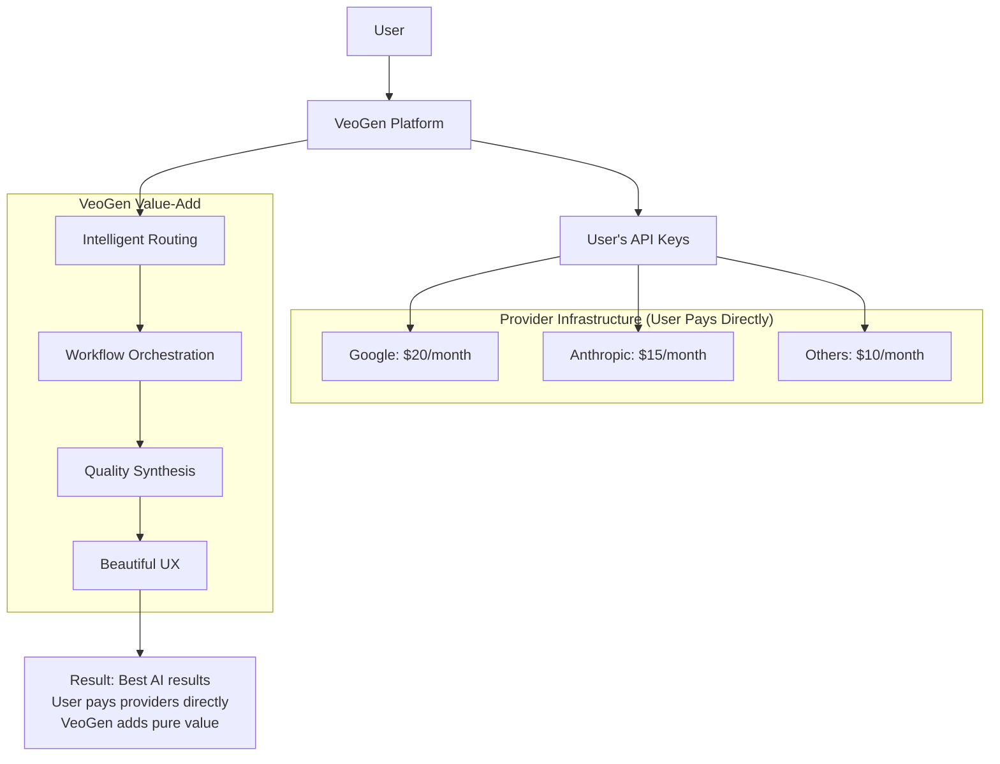

# VeoGen Vision: The Future of AI Orchestration

## Executive Summary

**VeoGen is evolving from a media generation platform to the world's first multi-provider AI orchestration system.** Instead of competing with Google and Anthropic, we orchestrate them - becoming the intelligent conductor that routes creative tasks to the best AI for each job.

**The Result**: Users get production-ready applications from simple descriptions, while VeoGen maintains lean, sustainable economics.

## The Real-Time Development Revolution

### AI Capabilities Evolve Before Your Eyes

**Traditional software wisdom is obsolete.** VeoGen itself proves the new reality: complex platforms with enterprise-grade infrastructure can be built in days, not months.

**Case Study: VeoGen Development**
- **Started**: "A few days ago"
- **Full monitoring stack** (Grafana, Loki, Prometheus): 20 minutes
- **Sophisticated architecture**: Backend, frontend, database, deployment
- **Traditional timeline**: 6-12 months with experienced team
- **AI-assisted reality**: Less than one week

**The "Mindboggling" Reality**: AI capabilities appear faster than AI systems "know" about them. iOS Claude created working export functionality while not knowing it existed. Development happens in real-time during conversation.

### Why "It Takes Years" is Dead

| Development Phase | Traditional | AI-Assisted | VeoGen Proven |
|-------------------|-------------|-------------|---------------|
| **Infrastructure** | 1-2 months | 20 minutes | Full monitoring stack |
| **Core Development** | 3-6 months | 2-3 days | Complete platform |
| **Documentation** | 1-2 weeks | Minutes | Comprehensive guides |
| **Total** | **6-12 months** | **1-2 weeks** | **<1 week** |

## The Strategic Breakthrough

### The Problem with Current AI Platforms

```
Current State: "Choose Your AI Champion"
┌─────────────┐  ┌─────────────┐  ┌─────────────┐
│   Google    │  │  Anthropic  │  │   OpenAI    │
│   (Great    │  │   (Great    │  │   (Great    │
│   Media)    │  │    Code)    │  │  Convo)     │
│             │  │             │  │             │
│  Weak Code  │  │ No Media    │  │ Avg Media   │
└─────────────┘  └─────────────┘  └─────────────┘
     Users forced to choose limitations
```

### VeoGen's Solution: Orchestrate, Don't Compete

```
VeoGen Future: "Conduct the AI Orchestra"
                ┌─────────────────┐
                │ VeoGen Conductor│
                │  Routes Tasks   │
                │   to Best AI    │
                └─────────┬───────┘
                          │
       ┌──────────────────┼──────────────────┐
       │                  │                  │
┌─────────────┐  ┌─────────────┐  ┌─────────────┐
│   Google    │  │  Anthropic  │  │   OpenAI    │
│ (Best Media)│  │ (Best Code) │  │(Best Convo) │
│ Always Used │  │ Always Used │  │ Always Used │
│ for Media   │  │  for Code   │  │ for Chat    │
└─────────────┘  └─────────────┘  └─────────────┘
     Best of all worlds, unified experience
```

## Revolutionary Architecture: Lean and Mean

### What We DON'T Build (The Heavy Lifting)
- ❌ Massive GPU clusters ($100M+ infrastructure)
- ❌ AI model training ($50M+ annually)
- ❌ Competing with Google/Anthropic research
- ❌ Bloated infrastructure that scales catastrophically

### What We DO Build (The Intelligence Layer)
- ✅ **Task Router**: Intelligently selects best AI for each job
- ✅ **Workflow Engine**: Orchestrates complex multi-step processes
- ✅ **Quality Synthesizer**: Combines outputs from different AIs
- ✅ **API Management**: Handles user credentials and optimization
- ✅ **User Experience**: Beautiful interfaces for creative workflows

### The "Bring Your Own API Keys" Genius



**Economics**: 
- User pays ~$45/month total to AI providers
- User pays $49-149/month to VeoGen for orchestration value
- VeoGen has no generation costs, pure software margins

## Complete Creative Workflows

### App Development: From Idea to App Store

**User Input**: *"Create a meditation app with nature sounds and progress tracking"*

**VeoGen Orchestration**:
1. **🧠 Claude** analyzes requirements → Technical architecture
2. **🎨 Imagen** generates UI mockups → Professional design system  
3. **🎵 Lyria** creates nature sounds → Custom audio library
4. **💻 Claude** implements React Native → Complete, tested codebase
5. **📚 Claude** writes documentation → User manual + API docs
6. **🎬 Veo** creates promotional video → Marketing assets
7. **🚀 Automated** builds and deploys → App store submission ready

**Timeline**: 5 minutes from description to deployable app
**Quality**: Production-ready, professional-grade results
**Cost**: ~$3-5 in API calls, infinitely better than manual development

### Beyond Apps: Complete Creative Ecosystem

| Workflow Type | Input | Orchestrated Output |
|---------------|-------|-------------------|
| **📱 Mobile Apps** | Description | Complete app + marketing + docs |
| **📚 Interactive Books** | Story concept | Illustrated book + narration + interactive features |
| **🎮 Game Prototypes** | Game idea | Playable prototype + soundtrack + trailer |
| **🏢 Business Tools** | Problem description | Web app + documentation + training materials |
| **🎓 Educational Content** | Learning objectives | Course + visuals + assessments + videos |
| **🎯 Marketing Campaigns** | Product info | Website + videos + graphics + copy |

## Competitive Advantages: Why VeoGen Wins

### 1. AI-Accelerated Development Reality
```
Traditional AI Platform Economics:
├─ AI Research: $50M/year
├─ GPU Infrastructure: $100M+ initial  
├─ Compute Costs: $20M+/month
├─ Always behind leaders: Priceless frustration
└─ Total: $300M+ to maybe compete

VeoGen Orchestration Economics:
├─ Engineering Team: $2M/year
├─ Cloud Infrastructure: $50K/month
├─ Provider API Costs: $0 (users pay directly)
├─ Always state-of-the-art: Latest models automatically
├─ Development Speed: Weeks instead of years
└─ Total: $10M to dominate orchestration
```

### 2. Real-Time Capability Evolution
- **Traditional**: 6+ months behind as we train models
- **VeoGen**: Real-time access to latest provider models
- **Innovation Speed**: Benefit from ALL AI research simultaneously
- **Capability Discovery**: AI abilities evolve during conversation

### 3. Provider Symbiosis
Instead of competing, we make providers MORE valuable:
- **Drive API Usage**: Bring them more customers
- **Better UX**: Make their capabilities more accessible  
- **Market Expansion**: Enable workflows they couldn't serve alone
- **Win-Win**: They benefit from our success

### 4. Risk Mitigation
- **No Technology Risk**: Don't depend on any single AI breakthrough
- **No Infrastructure Risk**: No massive capital investments
- **No Scaling Risk**: Costs stay fixed as usage grows
- **No Competition Risk**: Partners with leaders instead of competing

## Market Opportunity: $50B+ TAM

### Current Market Segmentation
```
Traditional Software Development: $1.7T
├─ Mobile App Development: $100B
├─ Web Development: $200B  
├─ Enterprise Software: $500B
├─ Creative Tools: $50B
└─ Content Creation: $100B

VeoGen Addressable Market: $500B+
├─ Automated App Development: $100B
├─ AI-Powered Content Creation: $200B
├─ Enterprise Workflow Automation: $150B
└─ Creative AI Orchestration: $50B+
```

### Market Evolution Timeline
- **2024**: Users confused by too many AI options
- **2025**: VeoGen establishes orchestration category ← **WE ARE HERE**
- **2026**: Orchestration becomes industry standard
- **2027**: AI agent ecosystems emerge with VeoGen at center

## Implementation Roadmap: AI-Accelerated Timeline

### Phase 1: MVP Orchestrator (Q2 2025)
**Investment**: $100K, 3 engineers, 3 weeks (not months)
```yaml
core_features:
  - Basic Claude vs Google routing
  - Simple API key management  
  - Single workflow (app generation)
  - Basic web interface

success_metrics:
  - 100 users successfully generate apps
  - 90%+ satisfaction with results
  - $10K+ monthly recurring revenue
```

### Phase 2: Advanced Orchestration (Q3 2025)  
**Investment**: $300K, 5 engineers, 2 months (not 6 months)
```yaml
enhanced_features:
  - Multi-provider complex workflows
  - Quality optimization algorithms
  - Cost management and routing
  - Enterprise security features
  - Team collaboration tools

success_metrics:
  - 1000+ active users
  - 50+ enterprise pilot customers
  - $100K+ monthly recurring revenue
  - 10+ different workflow types
```

### Phase 3: Platform Ecosystem (Q4 2025)
**Investment**: $1M, 10 engineers, 6 months (not 12 months)
```yaml
platform_features:
  - Custom provider integrations
  - Marketplace for workflows
  - Third-party developer APIs
  - Advanced enterprise features
  - Global deployment

success_metrics:
  - 10,000+ active users
  - 500+ enterprise customers
  - $1M+ monthly recurring revenue
  - 100+ third-party integrations
```

## Revenue Model: Pure Value Creation

### Subscription Tiers
```
🆓 STARTER (Free)
├─ 10 orchestrated workflows/month
├─ Basic provider routing  
├─ Community support
└─ Bring your own API keys

💡 CREATOR ($49/month)
├─ 1000 orchestrated workflows/month
├─ Advanced multi-provider workflows
├─ Priority routing optimization
├─ Email support
└─ Collaboration features

🚀 PROFESSIONAL ($149/month)  
├─ Unlimited orchestrated workflows
├─ Custom workflow creation
├─ Advanced provider optimization
├─ Priority support + SLA
├─ Team management
└─ API access

🏢 ENTERPRISE (Custom)
├─ Custom provider integrations
├─ On-premise deployment options
├─ Advanced security + compliance
├─ Dedicated support team
└─ Custom SLA guarantees
```

### Revenue Projections (AI-Accelerated)
```
Year 1 (2025): $1.2M ARR
├─ 1000 Creator users × $49 × 12 = $588K
├─ 200 Professional users × $149 × 12 = $358K  
├─ 20 Enterprise customers × $1000 × 12 = $240K
└─ Conservative growth assumptions

Year 2 (2026): $12M ARR  
├─ 10K Creator users × $49 × 12 = $5.9M
├─ 2K Professional users × $149 × 12 = $3.6M
├─ 200 Enterprise customers × $1500 × 12 = $3.6M
└─ Market expansion + enterprise adoption

Year 3 (2027): $50M ARR
├─ 50K Creator users × $49 × 12 = $29.4M
├─ 5K Professional users × $149 × 12 = $8.9M  
├─ 500 Enterprise customers × $2000 × 12 = $12M
└─ Platform effects + ecosystem growth
```

## The Perfect Team: Sandra + Sonnet

### Complementary Strengths
```
Sandra (Product & Strategy):        Sonnet (Technical & Architecture):
├─ Market insight & timing          ├─ System design & implementation
├─ User experience design           ├─ Provider API integrations  
├─ Business model innovation        ├─ Workflow optimization engines
├─ Go-to-market execution          ├─ Quality assurance systems
├─ Partnership development          ├─ Scalability & performance
└─ Fundraising & growth            └─ Security & reliability
```

### Execution Advantages
- **Lean Team**: Can move faster than big companies
- **No Legacy**: Don't have existing AI infrastructure to protect  
- **User-Centric**: Focus on workflows, not technology showcase
- **Partnership-Friendly**: Don't threaten existing providers
- **Technical Depth**: Deep understanding of AI capabilities and limitations
- **Market Timing**: Perfect intersection of AI maturity and user confusion

### Proven Development Speed
**VeoGen Case Study**: Complex platform with enterprise infrastructure built in less than one week. Traditional developers question: "Why so elaborate?" Reality: AI generated in 20 minutes what takes specialists weeks.

## Call to Action: The Orchestration Opportunity

### Why Now?
1. **Provider APIs are mature**: Google, Anthropic, OpenAI all have production APIs
2. **Market confusion**: Users overwhelmed by provider choices
3. **No incumbents**: Nobody is doing pure orchestration at scale
4. **AI-accelerated development**: Build and prove in weeks, not years
5. **Network effects**: First mover advantage compounds quickly

### The Big Question
**Every major AI company wants to be your only AI.**

**VeoGen becomes the conductor that makes them all play in harmony.**

The market opportunity is massive. The technical approach is sound. The team is perfectly positioned. The AI-accelerated timeline makes it immediate.

**The question isn't whether someone will build this. The question is: Will it be us?**

### Next Steps (AI-Accelerated Timeline)
1. **Build MVP orchestrator** (3 weeks) - Basic task routing + user testing
2. **Validate market fit** (2 months) - Enterprise pilots + revenue validation  
3. **Scale platform** (6 months) - Team growth + ecosystem development
4. **Dominate category** (12 months) - Market leadership + strategic partnerships

## Vision Statement

**VeoGen: Where AI providers compete to serve you better.**

From conversation to deployed application. From idea to app store. From concept to complete creative workflow.

**That's not a vision. With multi-provider orchestration and AI-accelerated development, it's a promise.**

---

*"In a world where every AI company wants to be your only AI, VeoGen becomes the conductor of the entire AI orchestra."*

**Sandra + Sonnet: Ready to conduct the future of AI?** 🚀 