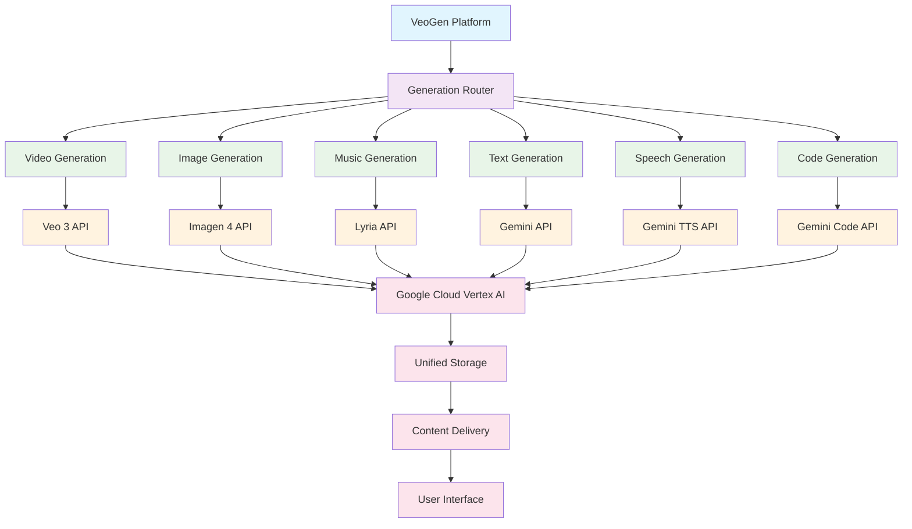

# Google AI Generation Ecosystem: Complete Capabilities Overview

## Introduction

Google's AI generation ecosystem extends far beyond the well-known trio of video (Veo), images (Imagen), and music (Lyria). This comprehensive guide explores the full spectrum of Google's generative AI capabilities, providing VeoGen developers and architects with insights into potential expansion opportunities and integration possibilities.

## Core Generation Categories

### 1. Visual Content Generation

#### **Video Generation - Veo 3**
- **Capability**: Text-to-video generation with photorealistic quality
- **Max Output**: Up to 4K resolution, 60+ seconds duration
- **Use Cases**: Film production, advertising, social media content
- **Access**: Vertex AI, VideoFX (experimental)
- **Status**: Production ready (2025)

#### **Image Generation - Imagen 4**
- **Capability**: Text-to-image generation with high fidelity
- **Max Output**: 2048x2048 pixels, multiple aspect ratios
- **Use Cases**: Digital art, marketing materials, web graphics
- **Access**: Vertex AI, Google AI Studio
- **Status**: Production ready (2025)

#### **3D Asset Generation - (Emerging)**
- **Capability**: Text-to-3D model generation
- **Max Output**: 3D meshes with textures
- **Use Cases**: Game development, AR/VR, product visualization
- **Access**: Limited research preview
- **Status**: Research/experimental

### 2. Audio Content Generation

#### **Music Generation - Lyria/MusicFX**
- **Capability**: Text-to-music generation across genres
- **Max Output**: 2+ minutes, professional audio quality
- **Use Cases**: Background music, jingles, creative composition
- **Access**: MusicFX, Vertex AI integration
- **Status**: Production ready (2024)

#### **Speech Generation - Gemini 2.5 TTS**
- **Capability**: Controllable text-to-speech with emotions
- **Max Output**: Natural voice synthesis, 24+ languages
- **Use Cases**: Audiobooks, podcasts, voice assistants
- **Access**: Gemini API, Vertex AI
- **Status**: Production ready (2025)

#### **Sound Effects Generation - (Emerging)**
- **Capability**: Text-to-sound effect generation
- **Max Output**: High-quality audio effects and ambiences
- **Use Cases**: Game audio, film post-production, podcasts
- **Access**: Research phase
- **Status**: Experimental

### 3. Text & Language Generation

#### **Long-form Text - Gemini Models**
- **Capability**: Articles, stories, documentation, code
- **Max Output**: Up to 2M tokens context window
- **Use Cases**: Content creation, technical writing, code generation
- **Access**: Gemini API, Google AI Studio, Vertex AI
- **Status**: Production ready (2025)

#### **Code Generation - Gemini Code Assist**
- **Capability**: Multi-language code generation and assistance
- **Max Output**: Complete applications, complex algorithms
- **Use Cases**: Software development, automation, debugging
- **Access**: Google Cloud Console, IDE integrations
- **Status**: Production ready (2025)

#### **Translation & Localization - Gemini + PaLM**
- **Capability**: Real-time translation across 100+ languages
- **Max Output**: Contextual, culturally-aware translations
- **Use Cases**: Global content distribution, communication
- **Access**: Google Translate API, Gemini API
- **Status**: Production ready (2025)

### 4. Conversational & Interactive Generation

#### **Real-time Dialogue - Gemini 2.5**
- **Capability**: Natural, context-aware conversations
- **Max Output**: Multi-turn dialogues with memory
- **Use Cases**: Customer service, virtual assistants, education
- **Access**: Gemini API with conversation modes
- **Status**: Production ready (2025)

#### **Voice Conversation - Gemini 2.5 Voice**
- **Capability**: Natural speech-to-speech interaction
- **Max Output**: Real-time voice conversations
- **Use Cases**: Voice assistants, accessibility tools
- **Access**: Gemini API, Google Assistant integration
- **Status**: Production ready (2025)

#### **Multi-speaker Dialogue - NotebookLM Style**
- **Capability**: Generate podcast-style conversations
- **Max Output**: Two-person audio discussions
- **Use Cases**: Educational content, content summarization
- **Access**: NotebookLM, Gemini API
- **Status**: Production ready (2024)

### 5. Multimodal Generation

#### **Video-to-Code - Gemini 2.5 Pro**
- **Capability**: Generate code from video demonstrations
- **Max Output**: Complete application code from UI mockups
- **Use Cases**: Rapid prototyping, UI development
- **Access**: Gemini 2.5 Pro via API
- **Status**: Production ready (2025)

#### **Document-to-Presentation - Gemini Workspace**
- **Capability**: Convert documents to slide presentations
- **Max Output**: Complete presentations with visuals
- **Use Cases**: Business presentations, educational materials
- **Access**: Google Workspace with Gemini
- **Status**: Production ready (2024)

#### **Image-to-Text Analysis - Gemini Vision**
- **Capability**: Detailed image analysis and description
- **Max Output**: Comprehensive text descriptions
- **Use Cases**: Accessibility, content moderation, analysis
- **Access**: Gemini API with vision capabilities
- **Status**: Production ready (2025)

## Emerging & Experimental Capabilities

### 1. Scientific Content Generation

#### **Molecular Structure Generation**
- **Capability**: AI-generated molecular structures for drug discovery
- **Research Partner**: DeepMind AlphaFold team
- **Use Cases**: Pharmaceutical research, materials science
- **Status**: Research collaboration

#### **Mathematical Proof Generation**
- **Capability**: Automated mathematical proof discovery
- **Research Partner**: DeepMind and academic institutions
- **Use Cases**: Mathematics research, theorem proving
- **Status**: Research phase

### 2. Interactive Media Generation

#### **Game Level Generation**
- **Capability**: Procedural game environment creation
- **Technology**: Combination of Imagen and code generation
- **Use Cases**: Game development, virtual worlds
- **Status**: Experimental

#### **Interactive Story Generation**
- **Capability**: Branching narrative creation with user choices
- **Technology**: Gemini with specialized fine-tuning
- **Use Cases**: Interactive fiction, educational simulations
- **Status**: Research phase

### 3. Specialized Professional Content

#### **Legal Document Generation**
- **Capability**: Contract and legal document drafting
- **Technology**: Gemini with legal training
- **Use Cases**: Legal practice automation, compliance
- **Status**: Research/pilot phase

#### **Medical Report Generation**
- **Capability**: Clinical documentation and analysis
- **Technology**: Med-PaLM integration with Gemini
- **Use Cases**: Healthcare documentation, diagnosis assistance
- **Status**: Research/clinical trials

## Integration Architecture for VeoGen

### Unified Generation Platform



### Cross-Modal Generation Workflows

#### **Video + Music + Narration**
```yaml
workflow_example:
  name: "Complete Video Production"
  steps:
    1. text_to_video:
        model: "veo-3"
        prompt: "Mountain landscape sunset"
        duration: 60
    
    2. text_to_music:
        model: "lyria"
        prompt: "Peaceful orchestral background"
        duration: 60
        sync_to_video: true
    
    3. text_to_speech:
        model: "gemini-tts"
        text: "Generated narration script"
        voice: "professional"
        sync_to_video: true
    
    4. compose_final:
        combine: [video, music, narration]
        output: "complete_production.mp4"
```

#### **Image + Caption + Code**
```yaml
workflow_example:
  name: "UI Mockup to Application"
  steps:
    1. text_to_image:
        model: "imagen-4"
        prompt: "Modern web dashboard UI"
        resolution: "1920x1080"
    
    2. image_to_description:
        model: "gemini-vision"
        input: generated_image
        output: detailed_description
    
    3. description_to_code:
        model: "gemini-code"
        input: ui_description
        framework: "react"
        output: "functional_app.jsx"
```

## Access Methods & Pricing

### Production APIs
- **Vertex AI**: Enterprise-grade access with SLA
- **Gemini API**: Developer-friendly access via Google AI Studio
- **Workspace Integration**: Built-in generation for business users

### Experimental Access
- **AI Test Kitchen**: Early access to experimental features
- **Research Partnerships**: Academic and industry collaboration
- **Developer Previews**: Limited-time access to new capabilities

### Pricing Considerations
- **Token-based pricing**: Most text generation
- **Per-generation pricing**: Image, video, music generation
- **Compute-based pricing**: Complex multimodal workflows
- **Enterprise pricing**: Custom rates for high-volume usage

## Future Roadmap Insights

### Short-term (2025)
- **Enhanced multimodal integration**
- **Real-time generation improvements**
- **Better cross-modal synchronization**
- **Expanded language support**

### Medium-term (2026-2027)
- **3D content generation**
- **Interactive media generation**
- **Personalized model training**
- **Edge deployment capabilities**

### Long-term (2028+)
- **General creative AI agents**
- **Full production pipeline automation**
- **Photorealistic virtual humans**
- **Scientific discovery acceleration**

## Implementation Recommendations for VeoGen

### Phase 1: Core Expansion
1. **Integrate Gemini TTS** for video narration
2. **Add code generation** for UI/UX prototyping
3. **Implement cross-modal workflows**

### Phase 2: Advanced Features
1. **3D asset generation** (when available)
2. **Interactive content creation**
3. **Personalized generation models**

### Phase 3: Ecosystem Integration
1. **Professional tool integrations**
2. **Marketplace development**
3. **Enterprise solutions**

## Competitive Landscape

### Google's Advantages
- **Unified ecosystem** across all generation types
- **Multimodal capabilities** from ground up
- **Enterprise infrastructure** and security
- **Research leadership** in AI/ML

### Areas for Improvement
- **Market penetration** vs OpenAI in some areas
- **Developer adoption** and community building
- **Pricing competitiveness** for smaller developers

## Security & Compliance

### Content Safety
- **SynthID watermarking** across all generated content
- **Content filtering** for all generation types
- **Copyright protection** mechanisms
- **User reporting** and moderation systems

### Enterprise Requirements
- **Data residency** options
- **Audit logging** for all generations
- **Access controls** and permissions
- **Compliance certifications** (SOC2, ISO27001)

## Conclusion

Google's AI generation ecosystem represents the most comprehensive suite of creative AI capabilities available from a single provider. For VeoGen, this presents opportunities to:

1. **Expand beyond video, images, and music** into text, speech, and code generation
2. **Create innovative cross-modal workflows** that combine multiple generation types
3. **Leverage Google's unified infrastructure** for seamless integration
4. **Access cutting-edge research capabilities** as they become available

The key to success lies in thoughtfully integrating these capabilities while maintaining VeoGen's focus on user experience and creative empowerment. As Google continues to advance the state of the art in AI generation, VeoGen is well-positioned to incorporate these innovations and provide users with an increasingly powerful and comprehensive creative AI platform.

## Additional Resources

- **Google AI Documentation**: [ai.google.dev](https://ai.google.dev)
- **Vertex AI Generative AI**: [cloud.google.com/vertex-ai/generative-ai](https://cloud.google.com/vertex-ai/generative-ai)
- **Google Research Publications**: [research.google](https://research.google)
- **AI Test Kitchen**: [aitestkitchen.withgoogle.com](https://aitestkitchen.withgoogle.com) 