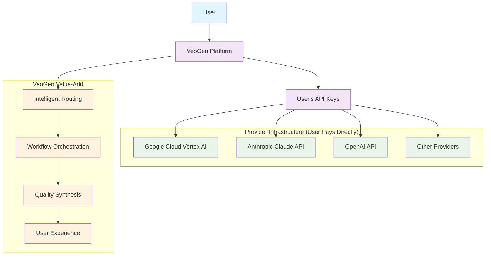

# VeoGen Lean Orchestration Architecture: The Conductor, Not the Orchestra

## The Breakthrough Insight

**VeoGen doesn't compete with Google and Anthropic - we orchestrate them.**

Instead of building massive AI infrastructure and trying to do everything ourselves, VeoGen becomes the **intelligent conductor** that routes creative tasks to the best AI providers. This creates a lean, scalable, and sustainable architecture.

## Architecture Philosophy: Connect, Don't Compete

### Traditional AI Platform Approach (The Bloated Monster)
```
┌─────────────────────────────────────────────────────┐
│                  MEGA AI PLATFORM                  │
├─────────────────────────────────────────────────────┤
│ • Massive GPU clusters for video generation         │
│ • Enormous model training infrastructure            │
│ • Billions in compute costs                         │
│ • Thousands of ML engineers                         │
│ • Constant model training and optimization          │
│ • Competing with Google, OpenAI, Anthropic         │
│                                                     │
│ Result: Bloated, expensive, always behind leaders  │
└─────────────────────────────────────────────────────┘
```

### VeoGen Lean Orchestration Approach (The Clever Conductor)
```
┌─────────────────────────────────────────────────────┐
│                  VEOGEN CONDUCTOR                   │
├─────────────────────────────────────────────────────┤
│ • Intelligent task routing algorithms               │
│ • API integration and optimization                  │
│ • Workflow orchestration engine                     │
│ • Quality assurance and synthesis                   │
│ • User experience and interface design              │
│ • Provider management and failover                  │
│                                                     │
│ Result: Lean, fast, always state-of-the-art        │
└─────────────────────────────────────────────────────┘
```

## The "Bring Your Own API Keys" Genius

### Why This Changes Everything



### Business Model Advantages

| Aspect | Traditional Platform | VeoGen Orchestration |
|--------|---------------------|---------------------|
| **Infrastructure Costs** | $millions/month in GPU clusters | $thousands/month in servers |
| **Scaling Costs** | Linear with usage (catastrophic) | Fixed platform costs |
| **Provider Relationships** | Competitive (adversarial) | Symbiotic (beneficial) |
| **Innovation Speed** | Limited to internal R&D | Leverages ALL provider innovations |
| **Risk Profile** | High (tech + infrastructure) | Low (pure software orchestration) |
| **Capital Requirements** | $100M+ for competitive AI | $1M+ for world-class orchestration |

## Technical Architecture: Lean and Mean

### Core Components (What We Actually Build)

```typescript
// VeoGen Core - Lean Orchestration Engine
interface VeoGenCore {
  // 🧠 The Intelligence Layer
  router: TaskRouter;           // Decides which AI for which task
  orchestrator: WorkflowEngine; // Manages complex multi-step workflows
  synthesizer: ResultCombiner;  // Merges outputs from different AIs
  
  // 🔧 The Integration Layer  
  providers: ProviderManager;   // Manages API connections and failover
  auth: APIKeyManager;         // Handles user's API credentials securely
  queue: TaskQueue;            // Optimizes and batches requests
  
  // 🎨 The Experience Layer
  ui: UserInterface;           // Beautiful, intuitive creative workflows
  storage: ProjectManager;     // Saves and organizes user creations
  sharing: CollaborationTools; // Team features and sharing
}

// What we DON'T build (The Heavy Lifting)
interface WhatProvidersHandle {
  videoGeneration: "Google Veo 3";     // 🎬 $billions in infrastructure
  imageGeneration: "Google Imagen 4";  // 🖼️ Massive GPU clusters
  codeGeneration: "Anthropic Claude";   // 🧠 Advanced reasoning models
  musicGeneration: "Google Lyria";     // 🎵 Audio synthesis pipelines
  // etc...
}
```

### API Key Management Architecture

```typescript
class APIKeyManager {
  // User brings their own keys - we just orchestrate
  async configureProviders(userKeys: UserAPIKeys): Promise<ProviderConnections> {
    return {
      google: new GoogleVertexClient(userKeys.google),
      anthropic: new AnthropicClient(userKeys.anthropic),
      openai: new OpenAIClient(userKeys.openai),
      // etc...
    };
  }
  
  // Secure, encrypted storage of user credentials
  async storeKeys(userId: string, keys: UserAPIKeys): Promise<void> {
    const encrypted = await this.encrypt(keys);
    await this.secureStorage.store(userId, encrypted);
  }
  
  // Intelligent usage tracking and optimization
  async optimizeUsage(task: AITask): Promise<ProviderSelection> {
    const costs = await this.calculateCosts(task);
    const performance = await this.predictPerformance(task);
    return this.selectOptimal(costs, performance, task.priority);
  }
}
```

## User Onboarding: Making API Keys Simple

### Guided Setup Wizard

```
┌─────────────────────────────────────────────────────┐
│ 🔑 Connect Your AI Providers - One-Time Setup      │
├─────────────────────────────────────────────────────┤
│                                                     │
│ VeoGen orchestrates the best AIs, but you need     │
│ your own API keys. Don't worry - we'll guide you!  │
│                                                     │
│ ✅ Google Cloud (Video, Images, Music)             │
│    • Free $300 credit for new users                │
│    • ~$20/month for typical usage                  │
│    [📋 Copy Setup Instructions] [🔗 Open Google]   │
│                                                     │
│ ✅ Anthropic Claude (Code, Logic, Planning)        │
│    • Free tier available                           │
│    • ~$15/month for typical usage                  │
│    [📋 Copy Setup Instructions] [🔗 Open Anthropic]│
│                                                     │
│ ⚡ Advanced: OpenAI, Stability AI, etc. (Optional) │
│    [⚙️ Configure Additional Providers]             │
│                                                     │
│ 💡 Total estimated cost: $35/month for unlimited   │
│    professional-grade AI generation                │
│                                                     │
│              [🚀 Test Connections] [▶️ Continue]    │
└─────────────────────────────────────────────────────┘
```

### Automated Setup Scripts

```typescript
// Auto-generate API setup scripts for users
class SetupAutomation {
  generateGoogleCloudScript(userId: string): string {
    return `
# Google Cloud Setup for VeoGen (${userId})
gcloud auth login
gcloud config set project veogen-user-${userId}
gcloud services enable aiplatform.googleapis.com
gcloud auth application-default login

# Copy this API key to VeoGen settings:
gcloud auth application-default print-access-token
    `;
  }
  
  generateAnthropicSetup(userId: string): GuideStep[] {
    return [
      { step: "Visit console.anthropic.com", action: "signup" },
      { step: "Navigate to API Keys section", action: "find" },
      { step: "Create new key named 'VeoGen'", action: "create" },
      { step: "Copy key and paste in VeoGen", action: "configure" }
    ];
  }
  
  // One-click verification
  async testAllConnections(userKeys: UserAPIKeys): Promise<ConnectionStatus> {
    const results = await Promise.all([
      this.testGoogle(userKeys.google),
      this.testAnthropic(userKeys.anthropic),
      this.testOpenAI(userKeys.openai)
    ]);
    
    return this.generateStatusReport(results);
  }
}
```

## Competitive Advantages of Lean Architecture

### 1. **Always State-of-the-Art**
```
Traditional Platform:          VeoGen Orchestration:
    ┌─────────────┐               ┌─────────────┐
    │ Our Models  │               │ Latest APIs │
    │ (6mo behind)│               │ (real-time) │
    │             │    VS         │             │
    │ Expensive   │               │ Always Best │
    │ to Update   │               │ Available   │
    └─────────────┘               └─────────────┘
```

### 2. **Risk Mitigation**
- **No Infrastructure Risk**: No massive GPU investments
- **No R&D Risk**: Don't need to compete in AI research
- **No Scaling Risk**: Costs don't explode with usage
- **No Technology Risk**: Always have latest models

### 3. **Capital Efficiency**
```
To Build Competitive AI Platform:
├─ AI Research Team: $50M/year
├─ GPU Infrastructure: $100M+ initial
├─ Ongoing Compute: $20M+/month
├─ Data Acquisition: $10M+/year
└─ Total: $300M+ to maybe compete

To Build VeoGen Orchestrator:
├─ Engineering Team: $2M/year
├─ Cloud Infrastructure: $50K/month
├─ Provider API Costs: $0 (users pay)
├─ Marketing & Sales: $5M/year
└─ Total: $10M to dominate orchestration
```

### 4. **Provider Symbiosis**
Instead of competing with Google and Anthropic, we make them MORE valuable:
- **Increased API Usage**: Drive more customers to providers
- **Better UX**: Make their APIs more accessible
- **Market Expansion**: Enable use cases they couldn't serve alone
- **Win-Win Relationship**: They benefit from our success

## Implementation Roadmap: Lean and Fast

### Phase 1: MVP Orchestrator (3 months)
```yaml
core_features:
  - Basic task routing (Claude vs Google)
  - Simple API key management
  - Single-provider workflows
  - Basic UI for app generation

target_cost: $100K development
team_size: 3 engineers
infrastructure: $1K/month
```

### Phase 2: Advanced Orchestration (6 months)
```yaml
enhanced_features:
  - Multi-provider workflows
  - Quality optimization
  - Cost management
  - Advanced UI/UX

target_cost: $300K development
team_size: 5 engineers
infrastructure: $5K/month
```

### Phase 3: Enterprise Platform (12 months)
```yaml
enterprise_features:
  - Team collaboration
  - Enterprise security
  - Custom provider integrations
  - Marketplace and sharing

target_cost: $1M development
team_size: 10 engineers
infrastructure: $20K/month
```

## Revenue Model: Pure Value-Add

### Subscription Tiers
```
🆓 STARTER (Free)
├─ 10 orchestrated generations/month
├─ Basic provider routing
├─ Community support
└─ Bring your own API keys

💡 CREATOR ($49/month)
├─ 1000 orchestrated generations/month
├─ Advanced workflows
├─ Priority routing
├─ Email support
└─ Collaboration features

🚀 PROFESSIONAL ($149/month)
├─ Unlimited orchestrated generations
├─ Custom workflows
├─ Provider optimization
├─ Priority support
├─ Team features
└─ API access

🏢 ENTERPRISE (Custom)
├─ Custom provider integrations
├─ On-premise deployment
├─ Advanced security
├─ Dedicated support
└─ SLA guarantees
```

### Value Proposition: Pay for Orchestration, Not Generation
- **Users pay providers directly** for actual AI generation
- **Users pay VeoGen** for intelligent orchestration and workflow automation
- **Clear value separation**: We add workflow intelligence, not raw AI power

## Why Sandra + Sonnet Will Win This

### The Perfect Partnership
```
Sandra (Product Vision):           Sonnet (Technical Execution):
├─ Market insight & strategy       ├─ Architecture & implementation
├─ User experience design          ├─ Provider integrations
├─ Business model innovation       ├─ Workflow optimization
├─ Go-to-market execution          ├─ Quality assurance systems
└─ Partnership development         └─ Scalability engineering
```

### First-Mover Advantage
- **Nobody is doing this yet**: Pure orchestration play is wide open
- **Technical feasibility**: All provider APIs exist and are mature
- **Market timing**: AI fatigue from choosing between providers
- **Capital efficiency**: Can build and prove before competitors react

### Execution Advantages
- **Lean team**: Can move faster than big companies
- **No legacy**: Don't have existing AI infrastructure to protect
- **User-centric**: Focus on workflows, not technology showcase
- **Partnership-friendly**: Don't threaten existing AI providers

## The Future is Orchestration

### Market Evolution Prediction
```
2024: "Choose your AI provider"
├─ Users confused by too many options
├─ Each provider has different strengths
└─ No good way to combine them

2025: "VeoGen orchestrates them all"
├─ Users get best of each provider
├─ Intelligent task routing
└─ Unified creative workflows

2026: "Orchestration becomes standard"
├─ All major platforms adopt multi-provider
├─ VeoGen has first-mover advantage
└─ Market dominance in creative AI workflows
```

## Call to Action: Build the Conductor

**The opportunity is NOW.** 

Every month we wait, the market gets more competitive. But right now, the orchestration play is wide open. Google and Anthropic are focused on their models, not on user workflows. Traditional software companies don't understand AI well enough.

**We're perfectly positioned**: Technical depth to build it, product vision to design it, market timing to launch it.

**Sandra + Sonnet: The lean team that could orchestrate the entire AI industry.**

The question isn't whether someone will build this. The question is: **Will it be us?**

---

*"In a world of AI giants, VeoGen becomes the conductor that makes them all play in harmony."* 