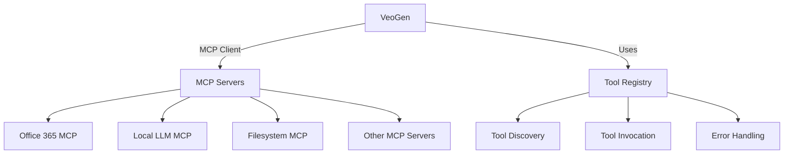

# MCP Client Integration

## Overview

The MCP (Model Control Protocol) client enables VeoGen to interact with various MCP servers, similar to Claude Desktop. This integration allows seamless communication with tools and services through a standardized protocol.

## Key Features

- **Auto-Discovery**: Automatically finds and connects to MCP servers from Claude Desktop's configuration
- **Tool Discovery**: Dynamically discovers available tools from connected MCP servers
- **Unified Interface**: Provides a consistent way to call tools across different MCP servers
- **Asynchronous**: Built on asyncio for non-blocking operations
- **Error Handling**: Comprehensive error handling and logging

## Architecture



## Configuration

The client automatically looks for MCP server configurations in these locations (in order of priority):

1. `C:\Users\sandr\AppData\Roaming\Claude\claude_desktop_config.json`
2. `%APPDATA%\Claude\claude_desktop_config.json`
3. `%APPDATA%\AnthropicClaude\claude-desktop-config.json`
4. `%LOCALAPPDATA%\AnthropicClaude\claude-desktop-config.json`

## Usage

### Initialization

```python
from app.services.mcp import mcp_client

# The client initializes automatically and connects to all configured MCP servers
```

### Discovering Tools

```python
# Get all available tools from all servers
all_tools = mcp_client.get_available_tools()

# Find a specific tool by name
email_tools = mcp_client.find_tool('send_email')
```

### Calling Tools

```python
# Call a tool on a specific server
result = await mcp_client.call_tool(
    server_name="microsoft-365",
    tool_name="send_email",
    params={
        "to": "user@example.com",
        "subject": "Hello from VeoGen",
        "body": "This is a test email sent via MCP"
    }
)
```

## Error Handling

The MCP client provides detailed error information through:

1. **Logging**: All operations are logged with appropriate log levels
2. **Return Values**: Methods return dictionaries with success/error information
3. **Exceptions**: Critical errors raise appropriate exceptions

## Security Considerations

- **Authentication**: MCP servers must handle their own authentication
- **Authorization**: Tool access should be controlled at the MCP server level
- **Sensitive Data**: Never log sensitive information like API keys or credentials

## Performance

- **Connection Pooling**: Reuses connections to MCP servers when possible
- **Async I/O**: Non-blocking operations for better performance
- **Caching**: Caches tool discovery results

## Monitoring

Monitor the MCP client using the following loggers:

- `app.services.mcp`: General MCP client operations
- `app.services.mcp.tools`: Tool discovery and invocation
- `app.services.mcp.transport`: Low-level communication with MCP servers
