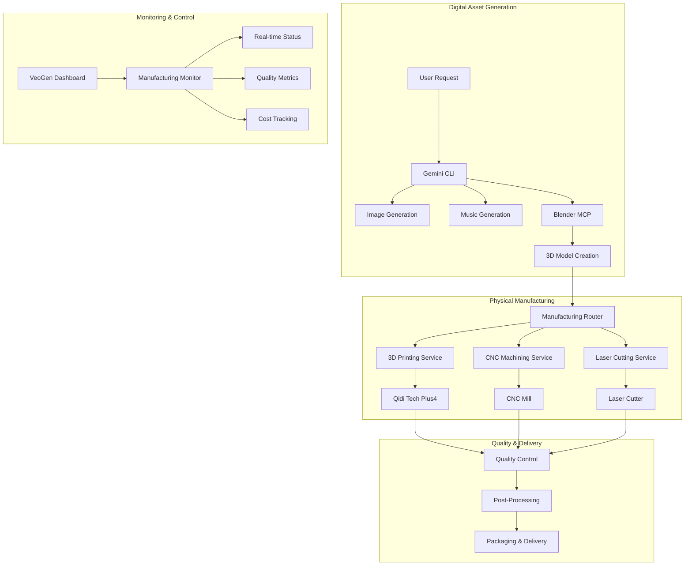

# Physical Manufacturing Integration Architecture

## Overview

VeoGen's Creative Automation Platform extends beyond digital asset generation to include physical manufacturing capabilities. This architecture document outlines how 3D printing, CNC machining, and other manufacturing processes integrate with our AI-driven design pipeline.

## Integration Architecture



## Manufacturing Router Service

### Service Architecture

```python
# manufacturing_router.py
from enum import Enum
from typing import Dict, Any, Optional
import asyncio

class ManufacturingMethod(Enum):
    PRINTING_3D = "3d_printing"
    CNC_MILLING = "cnc_milling"
    LASER_CUTTING = "laser_cutting"
    INJECTION_MOLDING = "injection_molding"

class ManufacturingRouter:
    def __init__(self):
        self.services = {
            ManufacturingMethod.PRINTING_3D: Printing3DService(),
            ManufacturingMethod.CNC_MILLING: CNCMillingService(),
            ManufacturingMethod.LASER_CUTTING: LaserCuttingService(),
        }
    
    async def route_manufacturing_request(self, request: Dict[str, Any]) -> Dict[str, Any]:
        """Route manufacturing request to appropriate service"""
        
        # Analyze design requirements
        analysis = await self.analyze_design_requirements(request)
        
        # Select optimal manufacturing method
        method = self.select_manufacturing_method(analysis)
        
        # Route to appropriate service
        service = self.services[method]
        result = await service.process_request(request)
        
        return {
            "method": method.value,
            "service_result": result,
            "analysis": analysis,
            "estimated_cost": result.get("cost"),
            "estimated_time": result.get("production_time")
        }
    
    def analyze_design_requirements(self, request: Dict[str, Any]) -> Dict[str, Any]:
        """Analyze design to determine manufacturing requirements"""
        
        model_file = request.get("model_file")
        material_requirements = request.get("materials", [])
        quantity = request.get("quantity", 1)
        tolerance = request.get("tolerance", "standard")
        
        # Analyze 3D model properties
        analysis = {
            "complexity": self.calculate_complexity(model_file),
            "material_compatibility": self.check_material_compatibility(material_requirements),
            "volume_requirements": self.calculate_volume(model_file),
            "surface_finish": request.get("surface_finish", "standard"),
            "strength_requirements": request.get("strength", "standard"),
            "quantity": quantity,
            "tolerance": tolerance
        }
        
        return analysis
    
    def select_manufacturing_method(self, analysis: Dict[str, Any]) -> ManufacturingMethod:
        """Select optimal manufacturing method based on analysis"""
        
        # Decision matrix for manufacturing method selection
        if analysis["quantity"] > 100:
            if analysis["material_compatibility"].get("injection_moldable"):
                return ManufacturingMethod.INJECTION_MOLDING
        
        if analysis["complexity"] == "high" and analysis["volume_requirements"] == "small":
            return ManufacturingMethod.PRINTING_3D
        
        if analysis["surface_finish"] == "precision" and analysis["material_compatibility"].get("machinable"):
            return ManufacturingMethod.CNC_MILLING
        
        if analysis["volume_requirements"] == "thin" and analysis["material_compatibility"].get("laser_cuttable"):
            return ManufacturingMethod.LASER_CUTTING
        
        # Default to 3D printing for prototyping
        return ManufacturingMethod.PRINTING_3D
```

## 3D Printing Service Integration

### Service Implementation

```python
# printing_3d_service.py
from integrations.qidi_printer import QidiPrinterController
import asyncio

class Printing3DService:
    def __init__(self):
        self.printers = {
            "qidi_plus4_01": QidiPrinterController("192.168.1.100", "api_key_1"),
            "qidi_plus4_02": QidiPrinterController("192.168.1.101", "api_key_2"),
        }
        self.material_profiles = {
            "PLA": {"temp": 210, "bed": 60, "chamber": 0},
            "ABS": {"temp": 250, "bed": 100, "chamber": 60},
            "PETG": {"temp": 240, "bed": 80, "chamber": 0},
            "Nylon": {"temp": 270, "bed": 120, "chamber": 65},
            "PC": {"temp": 290, "bed": 120, "chamber": 65}
        }
    
    async def process_request(self, request: Dict[str, Any]) -> Dict[str, Any]:
        """Process 3D printing request"""
        
        # Select available printer
        printer = await self.select_available_printer()
        
        # Prepare model for printing
        print_job = await self.prepare_print_job(request)
        
        # Submit and monitor print
        result = await self.execute_print_job(printer, print_job)
        
        return result
    
    async def select_available_printer(self) -> QidiPrinterController:
        """Select available printer based on current workload"""
        
        for printer_name, printer in self.printers.items():
            status = await printer.get_printer_status()
            if status["state"] == "Operational":
                return printer
        
        # If all busy, wait for first available
        while True:
            for printer_name, printer in self.printers.items():
                status = await printer.get_printer_status()
                if status["state"] == "Operational":
                    return printer
            await asyncio.sleep(60)  # Check every minute
    
    async def prepare_print_job(self, request: Dict[str, Any]) -> Dict[str, Any]:
        """Prepare model file for 3D printing"""
        
        model_file = request["model_file"]
        material = request.get("material", "PLA")
        quality = request.get("quality", "standard")
        
        # Slice model using appropriate slicer
        slicer_result = await self.slice_model(
            model_file=model_file,
            material=material,
            quality=quality,
            printer_profile="qidi_plus4"
        )
        
        return {
            "gcode_file": slicer_result["gcode_file"],
            "estimated_time": slicer_result["estimated_time"],
            "material_usage": slicer_result["material_usage"],
            "material": material,
            "quality": quality
        }
    
    async def slice_model(self, model_file: str, material: str, quality: str, printer_profile: str) -> Dict[str, Any]:
        """Slice 3D model into G-code"""
        
        # Integration with PrusaSlicer or OrcaSlicer
        slicer_config = {
            "input_file": model_file,
            "material_profile": material,
            "quality_profile": quality,
            "printer_profile": printer_profile,
            "output_file": f"/tmp/{model_file.stem}_{material}_{quality}.gcode"
        }
        
        # Execute slicer (implementation depends on chosen slicer)
        result = await self.execute_slicer(slicer_config)
        
        return result
```

## Cost and Time Estimation

### Manufacturing Cost Calculator

```python
# manufacturing_costs.py
from typing import Dict, Any
from decimal import Decimal

class ManufacturingCostCalculator:
    def __init__(self):
        self.material_costs = {
            # 3D Printing (per gram)
            "PLA": Decimal("0.024"),
            "ABS": Decimal("0.026"),
            "PETG": Decimal("0.030"),
            "Nylon": Decimal("0.045"),
            "PC": Decimal("0.055"),
            "Carbon_Fiber": Decimal("0.120"),
            
            # CNC Materials (per cm³)
            "Aluminum": Decimal("0.15"),
            "Steel": Decimal("0.08"),
            "Brass": Decimal("0.25"),
            "Delrin": Decimal("0.35"),
            
            # Laser Cutting (per cm²)
            "Acrylic_3mm": Decimal("0.02"),
            "Plywood_3mm": Decimal("0.015"),
            "Steel_1mm": Decimal("0.05")
        }
        
        self.machine_rates = {
            # Per hour rates
            "3d_printing": Decimal("5.00"),
            "cnc_milling": Decimal("45.00"),
            "laser_cutting": Decimal("25.00"),
            "injection_molding": Decimal("150.00")  # Setup cost
        }
    
    def calculate_3d_printing_cost(self, analysis: Dict[str, Any]) -> Dict[str, Decimal]:
        """Calculate 3D printing costs"""
        
        material = analysis.get("material", "PLA")
        volume_cm3 = analysis.get("volume_cm3", 0)
        print_time_hours = analysis.get("print_time_hours", 0)
        
        # Material cost (assuming 1.24g/cm³ density for PLA)
        density = 1.24 if material == "PLA" else 1.1
        material_weight = volume_cm3 * density
        material_cost = material_weight * self.material_costs[material]
        
        # Machine time cost
        machine_cost = Decimal(print_time_hours) * self.machine_rates["3d_printing"]
        
        # Post-processing cost (estimated)
        post_processing_cost = material_cost * Decimal("0.2")
        
        return {
            "material_cost": material_cost,
            "machine_cost": machine_cost,
            "post_processing_cost": post_processing_cost,
            "total_cost": material_cost + machine_cost + post_processing_cost
        }
    
    def calculate_cnc_cost(self, analysis: Dict[str, Any]) -> Dict[str, Decimal]:
        """Calculate CNC machining costs"""
        
        material = analysis.get("material", "Aluminum")
        volume_cm3 = analysis.get("volume_cm3", 0)
        machining_time_hours = analysis.get("machining_time_hours", 0)
        
        # Material cost
        material_cost = Decimal(volume_cm3) * self.material_costs[material]
        
        # Machine time cost
        machine_cost = Decimal(machining_time_hours) * self.machine_rates["cnc_milling"]
        
        # Setup cost
        setup_cost = Decimal("50.00")
        
        return {
            "material_cost": material_cost,
            "machine_cost": machine_cost,
            "setup_cost": setup_cost,
            "total_cost": material_cost + machine_cost + setup_cost
        }
```

## Quality Control Integration

### Automated Quality Inspection

```python
# quality_control.py
import cv2
import numpy as np
from typing import Dict, Any, List

class QualityControlService:
    def __init__(self):
        self.inspection_cameras = {
            "3d_printer_01": {"ip": "192.168.1.150", "type": "overhead"},
            "cnc_mill_01": {"ip": "192.168.1.151", "type": "multi_angle"}
        }
        
        self.quality_standards = {
            "dimensional_tolerance": 0.1,  # mm
            "surface_finish": "Ra 3.2",
            "defect_threshold": 0.02  # 2% of surface area
        }
    
    async def inspect_manufactured_part(self, manufacturing_result: Dict[str, Any]) -> Dict[str, Any]:
        """Perform automated quality inspection"""
        
        method = manufacturing_result["method"]
        part_id = manufacturing_result["part_id"]
        
        # Capture inspection images
        images = await self.capture_inspection_images(part_id, method)
        
        # Perform automated analysis
        inspection_results = []
        
        for image in images:
            # Dimensional analysis
            dimensional_check = self.check_dimensions(image, manufacturing_result["target_dimensions"])
            
            # Surface quality analysis
            surface_check = self.analyze_surface_quality(image)
            
            # Defect detection
            defect_check = self.detect_defects(image)
            
            inspection_results.append({
                "dimensional_accuracy": dimensional_check,
                "surface_quality": surface_check,
                "defects": defect_check
            })
        
        # Generate quality report
        quality_report = self.generate_quality_report(inspection_results, manufacturing_result)
        
        return quality_report
    
    def check_dimensions(self, image: np.ndarray, target_dimensions: Dict[str, float]) -> Dict[str, Any]:
        """Check dimensional accuracy using computer vision"""
        
        # Edge detection
        edges = cv2.Canny(image, 50, 150)
        
        # Find contours
        contours, _ = cv2.findContours(edges, cv2.RETR_EXTERNAL, cv2.CHAIN_APPROX_SIMPLE)
        
        if contours:
            largest_contour = max(contours, key=cv2.contourArea)
            
            # Calculate bounding box
            x, y, w, h = cv2.boundingRect(largest_contour)
            
            # Convert pixels to mm (calibration required)
            pixels_per_mm = 10  # Calibrated value
            measured_width = w / pixels_per_mm
            measured_height = h / pixels_per_mm
            
            # Compare with target dimensions
            width_error = abs(measured_width - target_dimensions.get("width", 0))
            height_error = abs(measured_height - target_dimensions.get("height", 0))
            
            return {
                "measured_width": measured_width,
                "measured_height": measured_height,
                "width_error": width_error,
                "height_error": height_error,
                "within_tolerance": (width_error <= self.quality_standards["dimensional_tolerance"] and 
                                   height_error <= self.quality_standards["dimensional_tolerance"])
            }
        
        return {"error": "Could not detect part boundaries"}
    
    def analyze_surface_quality(self, image: np.ndarray) -> Dict[str, Any]:
        """Analyze surface finish quality"""
        
        # Convert to grayscale
        gray = cv2.cvtColor(image, cv2.COLOR_BGR2GRAY)
        
        # Calculate surface roughness indicators
        # Laplacian variance (higher = more texture/roughness)
        laplacian_var = cv2.Laplacian(gray, cv2.CV_64F).var()
        
        # Histogram analysis for consistency
        hist = cv2.calcHist([gray], [0], None, [256], [0, 256])
        hist_std = np.std(hist)
        
        return {
            "surface_roughness_indicator": laplacian_var,
            "surface_consistency": hist_std,
            "quality_score": min(100, max(0, 100 - (laplacian_var / 10)))
        }
    
    def detect_defects(self, image: np.ndarray) -> Dict[str, Any]:
        """Detect surface defects like cracks, holes, layer delamination"""
        
        # Convert to grayscale
        gray = cv2.cvtColor(image, cv2.COLOR_BGR2GRAY)
        
        # Threshold to find defects
        _, binary = cv2.threshold(gray, 0, 255, cv2.THRESH_BINARY + cv2.THRESH_OTSU)
        
        # Find defect contours
        contours, _ = cv2.findContours(binary, cv2.RETR_EXTERNAL, cv2.CHAIN_APPROX_SIMPLE)
        
        defects = []
        total_defect_area = 0
        
        for contour in contours:
            area = cv2.contourArea(contour)
            if area > 50:  # Minimum defect size
                x, y, w, h = cv2.boundingRect(contour)
                defects.append({
                    "type": "surface_anomaly",
                    "area": area,
                    "location": {"x": x, "y": y, "width": w, "height": h}
                })
                total_defect_area += area
        
        # Calculate defect percentage
        total_area = image.shape[0] * image.shape[1]
        defect_percentage = (total_defect_area / total_area) * 100
        
        return {
            "defects_found": len(defects),
            "defect_list": defects,
            "defect_percentage": defect_percentage,
            "passes_inspection": defect_percentage <= (self.quality_standards["defect_threshold"] * 100)
        }
```

## Dashboard Integration

### Manufacturing Dashboard Widget

```python
# manufacturing_dashboard.py
from typing import Dict, Any, List

class ManufacturingDashboard:
    def __init__(self):
        self.active_jobs = {}
        self.completed_jobs = {}
        self.quality_metrics = {}
    
    def get_dashboard_data(self) -> Dict[str, Any]:
        """Get comprehensive manufacturing dashboard data"""
        
        return {
            "active_jobs": self.get_active_jobs_summary(),
            "production_metrics": self.get_production_metrics(),
            "quality_overview": self.get_quality_overview(),
            "cost_analysis": self.get_cost_analysis(),
            "capacity_utilization": self.get_capacity_utilization()
        }
    
    def get_active_jobs_summary(self) -> List[Dict[str, Any]]:
        """Get summary of active manufacturing jobs"""
        
        active_summary = []
        
        for job_id, job in self.active_jobs.items():
            active_summary.append({
                "job_id": job_id,
                "method": job["method"],
                "status": job["status"],
                "progress": job["progress"],
                "estimated_completion": job["estimated_completion"],
                "customer": job["customer"],
                "priority": job["priority"]
            })
        
        return active_summary
    
    def get_production_metrics(self) -> Dict[str, Any]:
        """Get production performance metrics"""
        
        # Calculate metrics from completed jobs
        completed_count = len(self.completed_jobs)
        total_production_time = sum(job["actual_time"] for job in self.completed_jobs.values())
        avg_production_time = total_production_time / completed_count if completed_count > 0 else 0
        
        return {
            "jobs_completed_today": self.count_jobs_completed_today(),
            "average_production_time": avg_production_time,
            "on_time_delivery_rate": self.calculate_on_time_rate(),
            "capacity_utilization": self.calculate_capacity_utilization(),
            "throughput_trend": self.get_throughput_trend()
        }
    
    def get_quality_overview(self) -> Dict[str, Any]:
        """Get quality metrics overview"""
        
        return {
            "overall_quality_score": self.calculate_overall_quality_score(),
            "defect_rate": self.calculate_defect_rate(),
            "rework_rate": self.calculate_rework_rate(),
            "quality_trend": self.get_quality_trend(),
            "top_quality_issues": self.get_top_quality_issues()
        }
```

## Future Manufacturing Capabilities

### Planned Integrations

1. **CNC Machining Service**
   - Integration with CNC mills for precision parts
   - Automatic tool path generation
   - Material optimization

2. **Laser Cutting Service**
   - 2D cutting from 3D models
   - Sheet material optimization
   - Automated nesting

3. **Injection Molding**
   - High-volume production capability
   - Mold design automation
   - Cost optimization for large quantities

4. **Pick and Place Assembly**
   - Automated assembly of multi-part designs
   - Electronic component integration
   - Testing and validation

### Scaling Strategy


## Conclusion

VeoGen's physical manufacturing integration creates a seamless bridge between digital design and physical reality. The modular architecture allows for easy expansion to additional manufacturing methods while maintaining consistent quality and cost controls.

**Key Benefits:**
- **Automated workflow**: From design to delivered product
- **Quality assurance**: Computer vision-based inspection
- **Cost optimization**: Real-time cost calculation and optimization
- **Scalability**: Modular design supports growth
- **Integration**: Seamless connection with existing VeoGen services 