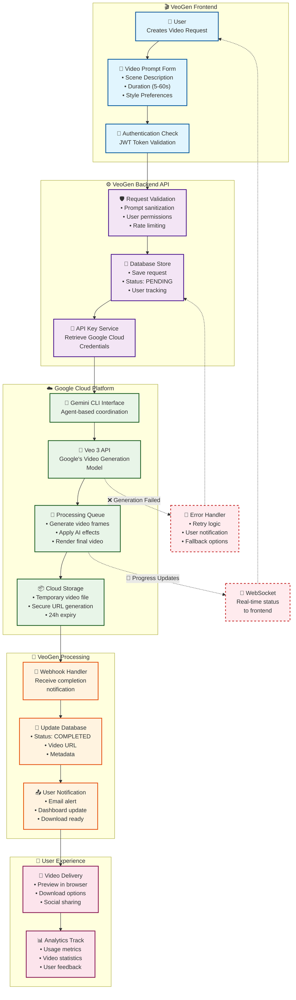

# VeoGen Video Generation Flow Architecture

## Overview

VeoGen provides a sophisticated, user-friendly interface for generating high-quality videos using Google's Veo 3 AI model. This document outlines the complete end-to-end flow from user request to video delivery, highlighting the system's architecture, security measures, and reliability features.

## System Architecture Diagram

## Detailed Flow Description

### 1. Frontend Layer (🎬 VeoGen Frontend)

#### User Interaction
The video generation process begins when a user accesses the VeoGen interface and creates a new video request. The frontend provides an intuitive form where users can:

- **Scene Description**: Enter detailed prompts describing the desired video content
- **Duration Selection**: Choose video length from 5 to 60 seconds
- **Style Preferences**: Select artistic styles, moods, and visual parameters
- **Advanced Options**: Configure aspect ratios, frame rates, and quality settings

#### Authentication & Security
Before any request processing, the system performs comprehensive authentication:
- **JWT Token Validation**: Ensures user session is valid and active
- **Permission Checks**: Verifies user has video generation privileges
- **Rate Limiting**: Prevents abuse by enforcing request quotas per user/time period

### 2. Backend API Layer (⚙️ VeoGen Backend API)

#### Request Processing Pipeline
The backend implements a robust processing pipeline with multiple validation stages:

**Input Validation & Sanitization**
- Prompt content filtering to prevent harmful or inappropriate requests
- Technical parameter validation (duration, resolution, format)
- Business rule enforcement (user quota, content policies)

**Database Operations**
- Request persistence with unique tracking IDs
- User activity logging for analytics and support
- Status tracking throughout the generation lifecycle
- Metadata storage for later retrieval and analysis

**API Key Management**
- Secure retrieval of Google Cloud credentials
- Dynamic key rotation for enhanced security
- Fallback key handling for high availability

### 3. Google Cloud Integration (☁️ Google Cloud Platform)

#### Gemini CLI Orchestration
VeoGen leverages Google's Gemini CLI as an intelligent coordinator that:
- **Agentic Processing**: Uses AI to optimize video generation parameters
- **Resource Management**: Efficiently allocates cloud resources
- **Quality Control**: Pre-processes prompts for optimal Veo 3 results
- **Cost Optimization**: Selects appropriate model configurations

#### Veo 3 Video Generation
The core video generation happens through Google's state-of-the-art Veo 3 model:
- **Advanced AI Processing**: Leverages cutting-edge computer vision and AI
- **High-Quality Output**: Produces professional-grade video content
- **Multiple Formats**: Supports various resolutions and aspect ratios
- **Style Transfer**: Applies artistic styles and visual effects

#### Processing & Storage
- **Distributed Processing**: Utilizes Google's global infrastructure
- **Secure Storage**: Temporary files stored with enterprise-grade security
- **CDN Distribution**: Fast global delivery through Google's CDN
- **Automatic Cleanup**: Files automatically deleted after 24 hours for privacy

### 4. VeoGen Processing Layer (🔄 VeoGen Processing)

#### Completion Handling
- **Webhook Integration**: Real-time notifications when videos are ready
- **Status Management**: Automatic database updates with completion data
- **Metadata Extraction**: Video properties, generation time, file size tracking
- **Quality Assurance**: Automated checks for video integrity and quality

#### User Communication
- **Multi-Channel Notifications**: Email alerts and dashboard updates
- **Progress Tracking**: Real-time status updates during generation
- **Error Communication**: Clear messaging for any issues encountered

### 5. User Experience Layer (📱 User Experience)

#### Video Delivery
- **Instant Preview**: Browser-based video playback
- **Multiple Download Options**: Various formats and quality levels
- **Social Integration**: Easy sharing to social media platforms
- **Permalink Generation**: Shareable URLs for collaboration

#### Analytics & Insights
- **Usage Tracking**: Detailed metrics on user behavior and preferences
- **Performance Analytics**: Generation times, success rates, quality metrics
- **User Feedback**: Rating systems and improvement suggestions

## Error Handling & Reliability

### Failure Recovery
The system implements comprehensive error handling:
- **Automatic Retries**: Failed generations are automatically retried with exponential backoff
- **Graceful Degradation**: Alternative processing paths when primary services are unavailable
- **User Communication**: Clear error messages with suggested actions
- **Support Integration**: Automatic ticket creation for persistent issues

### Real-Time Updates
- **WebSocket Connections**: Live progress updates without page refreshes
- **Status Broadcasting**: Real-time notifications across all user sessions
- **Queue Monitoring**: Visible position in processing queues

## Performance Characteristics

### Typical Processing Times
- **Simple Videos (5-15s)**: 2-5 minutes generation time
- **Complex Videos (30-60s)**: 5-15 minutes generation time
- **High-Quality Renders**: Additional 2-3 minutes for processing

### Scalability Features
- **Horizontal Scaling**: Backend services scale automatically with demand
- **Load Balancing**: Intelligent distribution across multiple processing nodes
- **Caching**: Intelligent caching of common requests and user preferences
- **CDN Integration**: Global content delivery for optimal performance

## Security & Privacy

### Data Protection
- **Encryption**: All data encrypted in transit and at rest
- **Temporary Storage**: Generated videos automatically deleted after download
- **User Privacy**: No long-term storage of personal video content
- **Audit Logging**: Comprehensive logs for security monitoring

### Access Control
- **Role-Based Access**: Different permission levels for various user types
- **API Rate Limiting**: Protection against abuse and overuse
- **IP Restrictions**: Optional IP-based access controls for enterprise users

## Integration Points

### External Services
- **Google Cloud Platform**: Primary video generation infrastructure
- **Email Services**: Notification delivery system
- **Analytics Platforms**: User behavior tracking and system monitoring
- **CDN Services**: Global content delivery optimization

### Internal Services
- **User Management**: Authentication and authorization
- **Billing System**: Usage tracking and payment processing
- **Support System**: Help desk and issue tracking
- **Monitoring**: System health and performance tracking

## Future Enhancements

### Planned Features
- **Batch Processing**: Multiple video generation in single requests
- **Template System**: Pre-built video templates for common use cases
- **Advanced Editing**: Post-generation editing and enhancement tools
- **API Access**: Programmatic access for enterprise integrations

### Performance Improvements
- **Predictive Caching**: AI-powered prediction of user requests
- **Edge Computing**: Local processing for faster response times
- **Advanced Compression**: Improved video compression for faster delivery

This architecture ensures VeoGen provides a reliable, scalable, and user-friendly platform for AI-powered video generation while maintaining high security standards and optimal performance. 