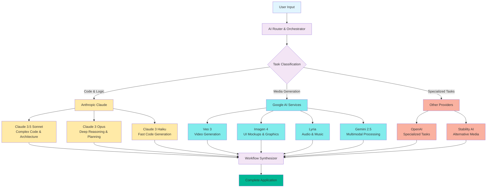
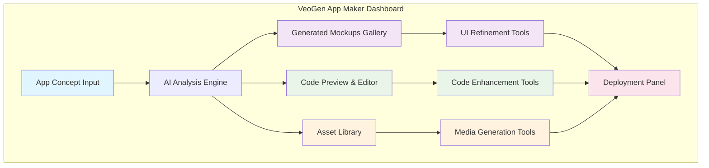

# VeoGen App Maker: AI-Powered End-to-End Application Development

## Vision Statement

VeoGen App Maker represents the evolution from individual media generation to **complete creative workflow automation**. By intelligently orchestrating multiple AI providers, we can transform simple descriptions into fully functional, deployable applications.

## Core Concept

**"From Conversation to App Store in One Workflow"**

User describes an app idea → VeoGen creates complete application with:
- Full-stack code implementation
- Professional UI/UX design
- Custom media assets (images, videos, music)
- Comprehensive documentation
- Automated testing and deployment

## Multi-Provider AI Architecture

### The Strategic Advantage

Rather than relying on a single AI provider, VeoGen leverages the **best capabilities** of each:



### Provider Specialization Matrix

| Task Category | Primary Provider | Reasoning |
|---------------|-----------------|-----------|
| **Code Architecture** | Anthropic Claude | Superior code generation, debugging, and system design |
| **UI/UX Design** | Google Imagen | High-quality visual design and mockup generation |
| **Video Content** | Google Veo | Best-in-class video generation capabilities |
| **Audio/Music** | Google Lyria | Professional quality music and sound generation |
| **Complex Reasoning** | Anthropic Claude | Better at multi-step planning and logical analysis |
| **Multimodal Processing** | Google Gemini | Native multimodal understanding from ground up |
| **Real-time Features** | Google Gemini | Low-latency processing and conversation |
| **Documentation** | Anthropic Claude | Superior technical writing and explanation |

## VeoGen App Maker Interface

### Main Dashboard



### Conversational Interface Design

**Step 1: App Concept Input**
```
┌─────────────────────────────────────────────────────┐
│ 🚀 Describe Your App Idea                          │
├─────────────────────────────────────────────────────┤
│                                                     │
│ "Create a meditation app with nature sounds,       │
│  progress tracking, and calming visuals"           │
│                                                     │
│ [Additional Details ▼]                             │
│ • Target Platform: iOS/Android/Web                 │
│ • Style Preference: Minimalist/Modern/Natural      │
│ • Key Features: Timer, Stats, Custom Sounds        │
│                                                     │
│              [✨ Generate App] [💾 Save Draft]      │
└─────────────────────────────────────────────────────┘
```

**Step 2: AI Analysis & Planning**
```
┌─────────────────────────────────────────────────────┐
│ 🧠 AI Analysis in Progress                          │
├─────────────────────────────────────────────────────┤
│                                                     │
│ ✅ Claude: Technical architecture planned           │
│ ⏳ Imagen: Generating UI mockups...                │
│ ⏳ Lyria: Creating nature soundscapes...           │
│ ⏳ Claude: Writing React Native code...            │
│                                                     │
│ Estimated completion: 3-5 minutes                  │
│                                                     │
│              [🔍 View Progress] [⏸️ Pause]          │
└─────────────────────────────────────────────────────┘
```

**Step 3: Generated Results Dashboard**
```
┌─────────────────────────────────────────────────────┐
│ 🎉 MeditateNow App Generated Successfully           │
├─────────────────────────────────────────────────────┤
│                                                     │
│ 📱 UI Mockups (6)    💻 Code Files (24)           │
│ ┌───┐ ┌───┐ ┌───┐    ├─ App.js                    │
│ │ 📱│ │ 🧘│ │ 📊│    ├─ components/                │
│ └───┘ └───┘ └───┘    ├─ screens/                  │
│ Main  Meditate Stats  ├─ services/                  │
│                       └─ __tests__/                 │
│                                                     │
│ 🎵 Audio Assets (8)   📚 Documentation             │
│ • Forest Rain.mp3     • Technical Specs            │
│ • Ocean Waves.mp3     • User Manual                │
│ • Bird Songs.mp3      • API Documentation          │
│                                                     │
│ [🔧 Customize] [📱 Preview] [🚀 Deploy] [💾 Export]│
└─────────────────────────────────────────────────────┘
```

## Complete Workflow Example

### Meditation App Generation Process

**User Input:**
> "Create a meditation app with nature sounds, progress tracking, and calming visuals"

**AI Orchestration Workflow:**

#### Phase 1: Analysis & Planning (Claude)
```yaml
task: "Analyze app requirements and create technical specification"
provider: "anthropic"
model: "claude-3-5-sonnet"
output:
  - Technical architecture document
  - Feature specifications
  - Technology stack recommendations
  - Development timeline
```

#### Phase 2: UI/UX Design (Imagen)
```yaml
task: "Generate mobile app UI mockups"
provider: "google"
model: "imagen-4"
prompts:
  - "Minimalist meditation app home screen with nature theme"
  - "Progress tracking dashboard with calming colors"
  - "Audio player interface with nature imagery"
  - "User profile and settings screens"
output:
  - 6 high-quality UI mockups
  - Consistent design system
  - Multiple device formats
```

#### Phase 3: Audio Content (Lyria)
```yaml
task: "Generate meditation and nature audio content"
provider: "google" 
model: "lyria"
prompts:
  - "Gentle forest rain with distant thunder - 10 minutes"
  - "Ocean waves on peaceful beach - 15 minutes"  
  - "Morning bird songs in quiet woodland - 12 minutes"
  - "Meditation bell chimes for session timing"
output:
  - 8 professional audio tracks
  - Multiple formats (MP3, FLAC)
  - Seamless looping capability
```

#### Phase 4: Code Implementation (Claude)
```yaml
task: "Implement complete React Native application"
provider: "anthropic"
model: "claude-3-5-sonnet"
requirements:
  - Cross-platform (iOS/Android)
  - Audio playback with background support
  - Progress tracking with local storage
  - Clean, maintainable architecture
output:
  - 24 code files
  - Complete app structure
  - Automated tests
  - Build configuration
```

#### Phase 5: Documentation (Claude)
```yaml
task: "Create comprehensive project documentation"
provider: "anthropic"
model: "claude-3-opus"
output:
  - Technical specification
  - API documentation
  - User manual
  - Deployment guide
  - Maintenance procedures
```

#### Phase 6: Marketing Assets (Veo + Imagen)
```yaml
task: "Generate promotional materials"
providers: ["google-veo", "google-imagen"]
output:
  - App store screenshots
  - Promotional video (30 seconds)
  - App icon variations
  - Marketing banners
```

## Technical Implementation

### AI Provider Integration Architecture

```typescript
// AI Router and Orchestrator
interface AIProvider {
  name: string;
  capabilities: string[];
  costPerRequest: number;
  averageLatency: number;
  qualityScore: number;
}

interface TaskRequest {
  type: 'code' | 'image' | 'video' | 'audio' | 'text' | 'analysis';
  complexity: 'low' | 'medium' | 'high';
  priority: 'speed' | 'quality' | 'cost';
  requirements: Record<string, any>;
}

class AIOrchestrator {
  providers: AIProvider[] = [
    {
      name: 'claude-3.5-sonnet',
      capabilities: ['code', 'analysis', 'documentation'],
      costPerRequest: 0.15,
      averageLatency: 3000,
      qualityScore: 0.95
    },
    {
      name: 'imagen-4',
      capabilities: ['image', 'ui-design'],
      costPerRequest: 0.08,
      averageLatency: 15000,
      qualityScore: 0.92
    },
    {
      name: 'veo-3',
      capabilities: ['video'],
      costPerRequest: 1.20,
      averageLatency: 45000,
      qualityScore: 0.94
    }
  ];

  async routeTask(task: TaskRequest): Promise<AIProvider> {
    // Intelligent routing based on task requirements
    const candidates = this.providers.filter(p => 
      p.capabilities.includes(task.type)
    );
    
    // Score each provider based on priority
    return candidates.reduce((best, current) => {
      const score = this.calculateScore(current, task);
      return score > this.calculateScore(best, task) ? current : best;
    });
  }

  private calculateScore(provider: AIProvider, task: TaskRequest): number {
    switch (task.priority) {
      case 'speed':
        return provider.qualityScore * 0.3 + (1 / provider.averageLatency) * 0.7;
      case 'quality':
        return provider.qualityScore * 0.8 + (1 / provider.costPerRequest) * 0.2;
      case 'cost':
        return (1 / provider.costPerRequest) * 0.7 + provider.qualityScore * 0.3;
    }
  }
}
```

### Workflow Engine

```typescript
interface WorkflowStep {
  id: string;
  name: string;
  provider: string;
  dependencies: string[];
  inputs: Record<string, any>;
  outputs: string[];
  estimatedDuration: number;
}

class AppMakerWorkflow {
  steps: WorkflowStep[] = [
    {
      id: 'analyze',
      name: 'Analyze Requirements',
      provider: 'claude-3.5-sonnet',
      dependencies: [],
      inputs: { userDescription: 'string' },
      outputs: ['technicalSpec', 'featureList'],
      estimatedDuration: 30000
    },
    {
      id: 'design',
      name: 'Generate UI Mockups',
      provider: 'imagen-4',
      dependencies: ['analyze'],
      inputs: { technicalSpec: 'object', stylePreferences: 'string' },
      outputs: ['uiMockups', 'designSystem'],
      estimatedDuration: 60000
    },
    {
      id: 'implement',
      name: 'Generate Code',
      provider: 'claude-3.5-sonnet',
      dependencies: ['analyze', 'design'],
      inputs: { technicalSpec: 'object', uiMockups: 'array' },
      outputs: ['sourceCode', 'testFiles'],
      estimatedDuration: 120000
    }
  ];

  async executeWorkflow(userInput: string): Promise<GeneratedApp> {
    const results = new Map();
    const completed = new Set();
    
    for (const step of this.steps) {
      // Wait for dependencies
      await this.waitForDependencies(step.dependencies, completed);
      
      // Execute step
      const provider = await this.orchestrator.routeTask({
        type: this.getTaskType(step),
        complexity: 'high',
        priority: 'quality',
        requirements: step.inputs
      });
      
      const result = await this.executeStep(step, provider, results);
      results.set(step.id, result);
      completed.add(step.id);
    }
    
    return this.synthesizeResults(results);
  }
}
```

## Deployment Automation

### One-Click Deployment Pipeline

```yaml
deployment_pipeline:
  name: "VeoGen App Maker Deployment"
  
  stages:
    - name: "Build"
      tasks:
        - npm install
        - npm run build
        - npm run test
    
    - name: "Package"
      tasks:
        - Generate app icons
        - Create store assets
        - Build platform binaries
    
    - name: "Deploy"
      options:
        - target: "app_store"
          automated: true
          review_required: false
        - target: "google_play"
          automated: true
          review_required: false
        - target: "web_hosting"
          provider: "vercel"
          domain: "auto-generated"
```

## Competitive Advantages

### Why Multi-Provider Beats Single-Provider

| Aspect | Single Provider | VeoGen Multi-Provider |
|--------|----------------|----------------------|
| **Code Quality** | Good (varies by provider) | Excellent (Claude specialization) |
| **Media Generation** | Good (varies by provider) | Excellent (Google specialization) |
| **Cost Optimization** | Fixed pricing | Dynamic provider selection |
| **Innovation Rate** | Limited to one research team | Best of all research teams |
| **Risk Mitigation** | Vendor lock-in | Provider redundancy |
| **Specialized Tasks** | Compromised quality | Best-in-class for each task |

### Where Claude/Anthropic Excels

1. **Code Architecture & Design**
   - Superior understanding of software patterns
   - Better at complex, multi-file codebases
   - More reliable debugging and optimization

2. **Technical Documentation**
   - Clearer, more comprehensive explanations
   - Better at creating user manuals and API docs
   - Superior code commenting and inline documentation

3. **Complex Reasoning & Planning**
   - Better at multi-step project planning
   - More reliable at following complex instructions
   - Superior at breaking down complex problems

4. **Safety & Reliability**
   - More conservative, production-ready code
   - Better error handling and edge case consideration
   - More thoughtful about security implications

## Future Roadmap

### Phase 1: Core App Maker (Q2 2025)
- Multi-provider AI integration
- Basic app generation workflow
- Simple deployment options

### Phase 2: Advanced Features (Q3 2025)
- Custom training on user preferences
- Advanced testing and optimization
- Enterprise deployment options

### Phase 3: Ecosystem Integration (Q4 2025)
- Third-party service integrations
- Marketplace for generated apps
- Collaborative development features

### Phase 4: AI Agent Evolution (2026)
- Autonomous maintenance and updates
- Intelligent feature suggestions
- Self-optimizing applications

## Business Model Innovation

### Revenue Streams
1. **Per-App Generation**: $29-99 per generated app
2. **Subscription Tiers**: Monthly plans for power users
3. **Enterprise Licensing**: Custom solutions for businesses
4. **Marketplace Revenue**: Commission on app sales
5. **Provider Partnerships**: Revenue sharing with AI providers

### Cost Optimization
- Intelligent provider routing minimizes costs
- Bulk API agreements with providers
- Caching and reuse of similar components
- Dynamic scaling based on demand

## Conclusion

VeoGen App Maker represents a paradigm shift from **tool-based AI** to **workflow-based AI**. By intelligently orchestrating multiple providers, we can achieve results that exceed what any single provider could accomplish alone.

The future of creative AI isn't about choosing the "best" provider - it's about intelligently combining the strengths of all providers to create something truly revolutionary.

**From idea to app store in one conversation.** That's the VeoGen promise. 