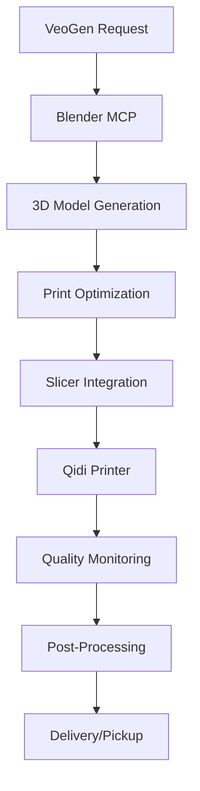

# 3D Printer Integration for VeoGen

## Overview

VeoGen's Creative Automation Platform integrates with professional 3D printers to enable automated physical prototyping and manufacturing of generated designs. This document outlines the recommended hardware, integration methods, and workflow automation capabilities.

## Recommended Hardware

### Primary Recommendation: Qidi Tech Plus4

**Price:** $769 USD  
**Why it's ideal for VeoGen:**

- **Excellent API/Network Control**: Uses standard Klipper firmware with full API access
- **High-temperature printing**: 65°C heated chamber, 370°C nozzle, 120°C bed
- **Professional features**: CoreXY, 500mm/s speed, enclosed chamber
- **No authorization restrictions**: Maintains open ecosystem unlike Bambu Lab
- **Large build volume**: 256×256×256mm
- **Industrial materials**: Handles carbon fiber, nylon, PC, ABS, ASA

**Technical Specifications:**
```yaml
Build Volume: 256×256×256mm
Print Speed: Up to 500mm/s
Nozzle Temperature: Up to 370°C
Bed Temperature: Up to 120°C
Chamber Temperature: Up to 65°C (actively heated)
Connectivity: WiFi, Ethernet, USB
Firmware: Klipper (open source)
API: Full REST API access
Camera: Built-in with streaming capabilities
```

### Budget Alternative: Qidi Tech Q1 Pro

**Price:** $419 USD  
**Solid mid-range option:**

- **Network controllable**: Full API access via Klipper
- **Enclosed chamber**: Better material compatibility
- **Professional grade**: Without the premium price
- **Good build volume**: Suitable for most projects

## Why NOT Bambu Lab

Despite technical excellence, Bambu Lab printers are **not recommended** due to recent authorization restrictions:

⚠️ **Major Issues:**
- **New firmware restrictions**: Requires proprietary Bambu Connect software
- **Third-party integration blocked**: No direct API access anymore
- **LAN mode limitations**: Requires cloud authorization even for local printing
- **Community backlash**: Major controversy over "enshittification" practices

## Integration Architecture

### Network Control Setup

```python
# VeoGen 3D Printer Integration
class QidiPrinterController:
    def __init__(self, printer_ip: str, api_key: str):
        self.base_url = f"http://{printer_ip}"
        self.api_key = api_key
        self.headers = {"X-Api-Key": api_key}
    
    def submit_print_job(self, gcode_file: str, job_name: str):
        """Submit G-code file for printing"""
        url = f"{self.base_url}/api/files/local"
        files = {'file': open(gcode_file, 'rb')}
        data = {'filename': f"{job_name}.gcode"}
        
        response = requests.post(url, files=files, data=data, headers=self.headers)
        return response.json()
    
    def start_print(self, filename: str):
        """Start printing uploaded file"""
        url = f"{self.base_url}/api/files/local/{filename}"
        data = {"command": "select", "print": True}
        
        response = requests.post(url, json=data, headers=self.headers)
        return response.json()
    
    def get_printer_status(self):
        """Get current printer status"""
        url = f"{self.base_url}/api/printer"
        response = requests.get(url, headers=self.headers)
        return response.json()
    
    def get_job_status(self):
        """Get current job progress"""
        url = f"{self.base_url}/api/job"
        response = requests.get(url, headers=self.headers)
        return response.json()
```

### Workflow Integration

```python
# VeoGen Automated 3D Printing Workflow
async def automated_3d_printing_workflow(design_request):
    # 1. Generate 3D model using Blender MCP
    model_data = await blender_mcp.generate_3d_model(design_request)
    
    # 2. Process model for 3D printing
    gcode = await slicer_service.slice_model(
        model_file=model_data.file_path,
        material="PLA",
        quality="high",
        supports=True
    )
    
    # 3. Submit to printer
    printer = QidiPrinterController("192.168.1.100", api_key)
    job_result = printer.submit_print_job(gcode, design_request.name)
    
    # 4. Start printing
    print_result = printer.start_print(job_result['filename'])
    
    # 5. Monitor progress
    while True:
        status = printer.get_job_status()
        if status['state'] == 'Operational':
            break
        await asyncio.sleep(30)  # Check every 30 seconds
    
    return {
        "status": "completed",
        "print_time": status['progress']['printTime'],
        "model_file": model_data.file_path,
        "gcode_file": gcode
    }
```

## Setup Instructions

### 1. Printer Setup

1. **Purchase Qidi Tech Plus4** from official store
2. **Complete initial setup** following manufacturer instructions
3. **Enable network connectivity** (WiFi or Ethernet)
4. **Install/update Klipper firmware** (usually pre-installed)
5. **Configure API access** and generate API key

### 2. Network Configuration

```yaml
# printer_config.yaml
printers:
  - name: "qidi_plus4_01"
    ip: "192.168.1.100"
    api_key: "your_api_key_here"
    build_volume: [256, 256, 256]
    materials: ["PLA", "ABS", "PETG", "TPU", "Nylon", "PC"]
    capabilities:
      heated_chamber: true
      max_temp_nozzle: 370
      max_temp_bed: 120
      max_temp_chamber: 65
```

### 3. Software Dependencies

```bash
# Install required Python packages
pip install requests websocket-client pillow

# Install slicer software
# Option 1: PrusaSlicer (recommended)
wget https://github.com/prusa3d/PrusaSlicer/releases/latest/download/PrusaSlicer-linux-x64.AppImage

# Option 2: OrcaSlicer (advanced)
wget https://github.com/SoftFever/OrcaSlicer/releases/latest/download/OrcaSlicer_Linux_V2.0.0.tar.gz
```

### 4. Integration Testing

```python
# Test printer connectivity
def test_printer_connection():
    printer = QidiPrinterController("192.168.1.100", "your_api_key")
    
    try:
        status = printer.get_printer_status()
        print(f"Printer connected: {status['state']}")
        print(f"Temperature: {status['temperature']}")
        return True
    except Exception as e:
        print(f"Connection failed: {e}")
        return False

# Run test
if test_printer_connection():
    print("✅ Printer integration ready!")
else:
    print("❌ Setup required")
```

## Materials and Capabilities

### Supported Materials

| Material | Temperature | Use Cases | VeoGen Applications |
|----------|-------------|-----------|-------------------|
| **PLA** | 210°C | Prototypes, decorative | General prototyping |
| **ABS** | 250°C | Functional parts | Durable prototypes |
| **PETG** | 240°C | Clear/flexible parts | Transparent components |
| **TPU** | 230°C | Flexible parts | Gaskets, phone cases |
| **Nylon** | 270°C | Strong mechanical | Engineering parts |
| **PC** | 290°C | High-strength | Industrial applications |
| **Carbon Fiber** | 300°C | Lightweight/strong | Aerospace prototypes |

### Quality Settings

```python
# Slicer profiles for different use cases
QUALITY_PROFILES = {
    "draft": {
        "layer_height": 0.3,
        "infill": 15,
        "speed": 100,
        "use_case": "Rapid prototyping"
    },
    "standard": {
        "layer_height": 0.2,
        "infill": 20,
        "speed": 60,
        "use_case": "General printing"
    },
    "high": {
        "layer_height": 0.1,
        "infill": 25,
        "speed": 40,
        "use_case": "Detailed models"
    },
    "functional": {
        "layer_height": 0.2,
        "infill": 40,
        "speed": 50,
        "use_case": "Mechanical parts"
    }
}
```

## Monitoring and Automation

### Real-time Monitoring

```python
# WebSocket connection for real-time updates
import websocket
import json

class PrinterMonitor:
    def __init__(self, printer_ip, api_key):
        self.ws_url = f"ws://{printer_ip}/sockjs/websocket"
        self.api_key = api_key
    
    def on_message(self, ws, message):
        data = json.loads(message)
        if data.get('current'):
            # Update VeoGen dashboard
            self.update_print_progress(data['current'])
    
    def on_error(self, ws, error):
        print(f"WebSocket error: {error}")
    
    def start_monitoring(self):
        websocket.enableTrace(True)
        ws = websocket.WebSocketApp(
            self.ws_url,
            on_message=self.on_message,
            on_error=self.on_error
        )
        ws.run_forever()
```

### Failure Detection

```python
# Automated failure detection
def detect_print_failures(status_data):
    failures = []
    
    # Temperature issues
    if status_data['temperature']['tool0']['actual'] < 180:
        failures.append("Nozzle temperature too low")
    
    # Layer adhesion problems
    if status_data.get('layer_count', 0) > 10:
        if status_data['progress']['completion'] < 5:
            failures.append("Poor first layer adhesion")
    
    # Filament runout
    if status_data.get('filament_detected') == False:
        failures.append("Filament runout detected")
    
    return failures
```

## Cost Analysis

### Hardware Investment

| Component | Cost | Justification |
|-----------|------|---------------|
| **Qidi Tech Plus4** | $769 | Primary printer |
| **Additional filaments** | $200 | Material variety |
| **Backup parts** | $100 | Maintenance |
| **Network setup** | $50 | Connectivity |
| **Total Initial** | **$1,119** | Complete setup |

### Operating Costs

| Item | Monthly Cost | Notes |
|------|-------------|-------|
| **Electricity** | $15-25 | 24/7 operation |
| **Filament consumption** | $50-100 | Based on usage |
| **Maintenance** | $10-20 | Wear parts |
| **Total Monthly** | **$75-145** | Variable usage |

## Integration with VeoGen Ecosystem

### Blender MCP → 3D Printing Pipeline

```python
# Complete workflow from design to physical object
async def design_to_print_workflow(prompt: str):
    # 1. Generate 3D model
    model = await blender_mcp.create_model_from_prompt(prompt)
    
    # 2. Optimize for 3D printing
    optimized_model = await blender_mcp.optimize_for_printing(
        model_id=model.id,
        printer_constraints={
            "build_volume": [256, 256, 256],
            "min_feature_size": 0.2,
            "support_overhang_angle": 45
        }
    )
    
    # 3. Export for slicing
    stl_file = await blender_mcp.export_stl(optimized_model.id)
    
    # 4. Slice and print
    result = await automated_3d_printing_workflow({
        "name": prompt.replace(" ", "_"),
        "model_file": stl_file,
        "material": "PLA",
        "quality": "standard"
    })
    
    return result
```

### Dashboard Integration

```python
# Add 3D printing status to VeoGen dashboard
def add_printer_widget():
    return {
        "widget_type": "3d_printer_status",
        "title": "3D Printer Status",
        "data": {
            "printer_name": "Qidi Plus4",
            "status": "printing",
            "progress": 67,
            "time_remaining": "2h 34m",
            "current_job": "phone_stand_v3.gcode",
            "material": "PLA",
            "nozzle_temp": 210,
            "bed_temp": 60
        }
    }
```

## Security and Access Control

### Network Security

```python
# Secure printer access
class SecurePrinterAccess:
    def __init__(self, printer_config):
        self.config = printer_config
        self.session = requests.Session()
        self.session.headers.update({
            "X-Api-Key": self.config['api_key'],
            "User-Agent": "VeoGen-Automation/1.0"
        })
    
    def validate_gcode(self, gcode_content):
        """Validate G-code for security issues"""
        dangerous_commands = ['M999', 'M112', 'M502']
        
        for line in gcode_content.split('\n'):
            for cmd in dangerous_commands:
                if cmd in line:
                    raise SecurityError(f"Dangerous command detected: {cmd}")
        
        return True
```

### Access Control

```yaml
# printer_access.yaml
access_control:
  admin_users: ["sandra@veogen.com"]
  print_users: ["team@veogen.com"]
  view_only: ["guest@veogen.com"]
  
permissions:
  admin:
    - start_print
    - stop_print
    - modify_settings
    - firmware_update
  print:
    - start_print
    - stop_print
    - upload_files
  view:
    - monitor_status
    - view_history
```

## Troubleshooting

### Common Issues

| Issue | Symptoms | Solution |
|-------|----------|----------|
| **Connection timeout** | Cannot reach printer | Check network, firewall |
| **Print fails to start** | File uploads but won't print | Verify G-code format |
| **Poor print quality** | Layer issues, warping | Adjust temperature, speed |
| **API errors** | 401/403 responses | Check API key validity |

### Diagnostic Commands

```python
# Printer diagnostics
def run_diagnostics(printer):
    results = {}
    
    # Test connectivity
    try:
        status = printer.get_printer_status()
        results['connectivity'] = 'OK'
    except:
        results['connectivity'] = 'FAILED'
    
    # Test temperature control
    try:
        temp_data = status['temperature']
        results['temperature'] = 'OK' if temp_data else 'FAILED'
    except:
        results['temperature'] = 'FAILED'
    
    # Test file operations
    try:
        files = printer.get_files()
        results['file_system'] = 'OK'
    except:
        results['file_system'] = 'FAILED'
    
    return results
```

## Future Enhancements

### Planned Features

1. **Multi-printer management**: Scale to printer farm
2. **AI-powered quality control**: Computer vision inspection
3. **Material auto-switching**: Automated material changes
4. **Predictive maintenance**: AI-driven maintenance scheduling
5. **Custom slicing profiles**: AI-optimized print settings

### Integration Roadmap



## Conclusion

The Qidi Tech Plus4 provides the ideal foundation for VeoGen's 3D printing integration, offering professional capabilities with full API control. The open-source ecosystem ensures long-term compatibility and extensibility, while the heated chamber enables printing with advanced materials for prototyping and manufacturing applications.

**Next Steps:**
1. Order Qidi Tech Plus4 printer
2. Set up network connectivity and API access
3. Implement basic integration scripts
4. Test with simple Blender MCP models
5. Scale to full workflow automation 